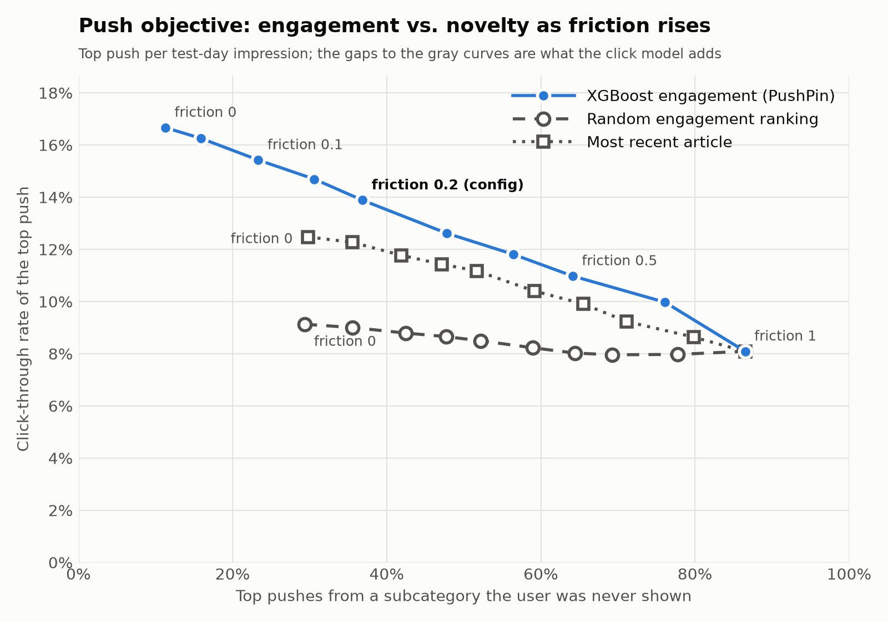
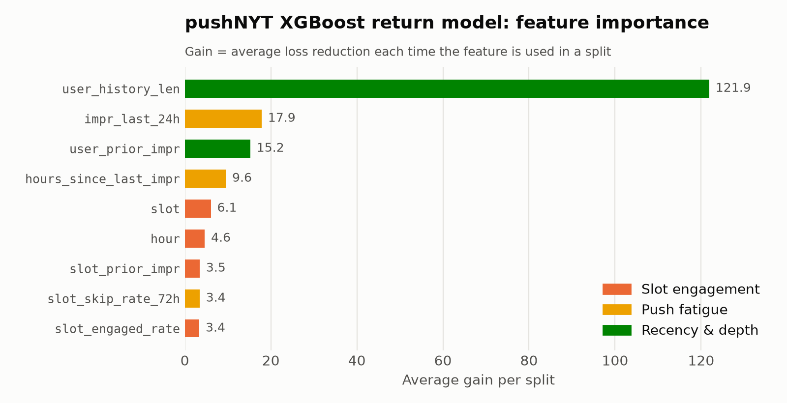
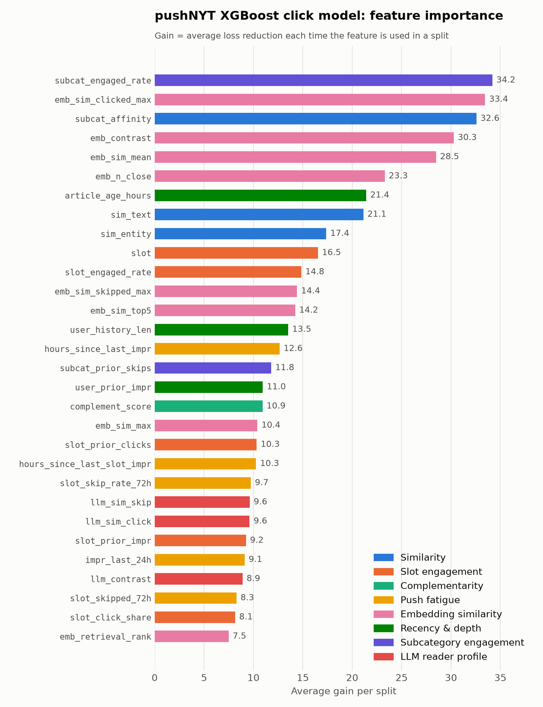

# Analysis: objective, calibration, send policy, user behavior

Deep dives behind the numbers in the [README](../README.md). Images are produced by `src/pushnyt/plots.py`.

## Push objective

The click model answers "will they click?"; the push objective decides what to actually send.
For each candidate in an impression:

```
score = (1 − friction) · engagement + friction · novelty,     friction ∈ [0, 1]
```

- **engagement** — the XGBoost `P(click)`.
- **novelty** — `1 − share of the user's earlier exposure in the candidate's subcategory`, where
  exposure is their pre-period history clicks plus every article shown in earlier impressions.
  1 = a subcategory they have never been shown; near 0 = what they are usually shown.

**Same scale.** The raw values aren't comparable. `P(click)` sits near the base CTR (~0.04),
while novelty spans 0–1, so adding them raw would let novelty swamp engagement. Each half is
therefore converted to its **percentile rank among the candidates in the same impression**. That
makes friction a literal weight between two rankings, and it isn't affected by recalibrating
`P(click)`.

**Baseline click rates.** Clicks are rare. On the test day (30,270 impressions, 1.22M candidates):

| What | Click rate |
|------|------------|
| Any single candidate shown | 3.8% |
| One candidate picked at random from each impression | 9.1% |
| The model's top pick per impression (friction 0) | 16.7% |

A random pick beats the per-candidate rate because MIND only logs impressions with a click, and
short impressions have a high click share. So 9.1% is the fair random baseline, and the model
nearly doubles it. These are feed impressions, so real push click rates would be lower.

**The trade-off.** `pushnyt-objective` sweeps friction and plots, for the single top push per
impression, the click rate against the share of pushes from a never-shown subcategory. The dashed
curve repeats the same objective with the click model swapped for a random ranking, so the gap
between the curves is what the model adds at each level of novelty (`recency-depth-no-emb` model):



| Friction | CTR of top pick | …with random engagement | Top pick from a never-shown subcategory |
|----------|-----------------|-------------------------|-----------------------------------------|
| 0 | 16.7% | 9.1% | 11% |
| 0.05 | 16.3% | 9.0% | 16% |
| 0.1 | 15.4% | 8.8% | 23% |
| 0.15 | 14.7% | 8.7% | 31% |
| 0.2 (default) | 13.9% | 8.5% | 37% |
| 0.3 | 12.6% | 8.2% | 48% |
| 0.4 | 11.8% | 8.0% | 56% |
| 0.5 | 11.0% | 8.0% | 64% |
| 0.7 | 10.0% | 8.0% | 76% |
| 1 | 8.1% | 8.1% | 87% |

Low friction buys novelty cheaply: going from 0 to 0.2 more than triples the never-shown share
for about 3 points of CTR. Above about 0.5 the model keeps less and less of its edge. CTR only
credits logged clicks, so it likely understates how novel pushes would do.

## Calibration

A ranking only needs scores in the right order. A **send/don't-send decision** needs them to be
right in absolute terms: of all pushes scored 0.10, about 10% should be clicked. That property is
calibration, and models trained for ranking often lack it (gradient boosting with early stopping
tends to be over- or under-confident in the tails).

`pushnyt-train` applies **Platt scaling**: it fits `p = sigmoid(a · logit(raw) + b)` on the
held-out early-stopping slice and applies it to the test day. The mapping is strictly increasing,
so rankings, AUC, and the push objective's choices are unchanged; only the probability scale
moves. (Isotonic regression is the more flexible alternative, but it creates ties, which would
change the objective's rankings.)


| | Raw XGBoost | Calibrated |
|---|---|---|
| Expected calibration error (ECE) | 0.35 pts | **0.24 pts** |
| Brier score | 0.03635 | **0.03630** |
| Top bin: predicted → observed | 13.2% → 10.9% | **11.1% → 10.9%** |

On average the raw model was already close; the fix matters at the top, where it was
**overconfident**, and the top is exactly where a send threshold operates. ECE is the
count-weighted mean gap between predicted and observed rates over 20 equal-count bins.

**MIND caveats.** Calibration is per *candidate*, not per chosen push, and MIND only logs
impressions that contain a click. Small impressions therefore have inflated click rates (18.6%
with ≤10 candidates vs 1.9% with >100), and the model can't see impression size. The labels also
mean "picked from this list", not "wants this article": candidates shown together compete for
about one click. So the 0.07 send threshold is in feed units (a top pick from about 37
candidates), not the chance of opening a lone notification. The send policy is evaluated on
impressions with 50+ candidates, where the artifact is weakest. Within those, top picks still
click more as the prediction rises (3.6% → 8.5% across quintiles), but the model over-predicts the
level. Two possible fixes are an impression-size feature fixed at a reference value at push time,
or weighting each impression once. Real push logs are the proper source (see
[Production](#production-plugging-in-real-opt-out-data) and
[Real pushes to your phone](notifier.md)).

## Return model (churn proxy)

The real cost of a bad push is a reader turning notifications off. MIND has no opt-out events, so
`pushnyt-train` fits a proxy: **P(the user has another impression within 24 hours)**, an XGBoost
model on user depth and fatigue features (`src/pushnyt/risk.py`). Risk = 1 − P(return).

- Labels are censored near the end of the log, so it trains on impressions before `fit_end`,
  is evaluated on `[fit_end, train_end)` (**AUC 0.743**, 54% return rate), and only scores the test day.
- It is a **user-level** signal: it mostly measures how active someone is, not what a push did to
  them. Subtracting it from the per-article score would barely change which article wins (it is
  nearly constant within an impression), so it sets **how much** to send each user, not **what**.
- The feature importances confirm it: a split on `user_history_len` (pre-log click count) reduces
  the loss about 7× as much as a split on any other feature, followed by recent activity
  (`impr_last_24h`, `user_prior_impr`, `hours_since_last_impr`). The engagement and skip-rate
  features add little.



## Send policy

For each impression's top pick (at the configured friction), `pushnyt-objective` sends it only if

```
calibrated P(click) ≥ threshold + risk_penalty · (1 − P(return))
```

and the user has had fewer than `daily_cap` pushes that day (earliest first; the policy can't see
later impressions). Defaults in `configs/objective.yml`: threshold 0.07, risk penalty 0.04, cap 2.
At-risk users therefore only get pushes the model is more confident about.


On impressions with 50+ candidates:

| Threshold | Pushes per active user-day | CTR of pushes sent | Predicted CTR |
|-----------|----------------------------|--------------------|---------------|
| 0 (send all, cap 2) | 1.15 | 5.3% | 8.1% |
| 0.05 | 0.72 | 6.4% | 9.4% |
| **0.07 (default)** | **0.41** | **7.9%** | 10.9% |
| 0.10 | 0.14 | 10.3% | 13.9% |
| 0.15 | 0.02 | 17.4% | 19.1% |

Raising the threshold trades volume for quality as intended. At the default, low-risk users get
0.82 pushes/day at 9.3% CTR and high-risk users 0.15/day at 5.3%. The model over-predicts
on this slice, most for high-risk users, which is the impression-size caveat above plus a sign
that a production calibrator should be fit per user segment.

## Production: plugging in real opt-out data

In production the return proxy should be replaced by a model of actual notification opt-outs.
What NYT would need to log:

| Event | Fields | Used for |
|-------|--------|----------|
| Push sent | user, article, time, slot, model scores, **send probability** | Training data; off-policy evaluation of new policies |
| Push opened | user, article, time | The click label (replaces MIND impressions) |
| Push dismissed | user, article, time | Article-level negative feedback |
| Notifications disabled / app uninstalled | user, time, pushes in the prior 7 days | The opt-out model's label |

A user-level opt-out model drops straight into the send policy in place of `p_return`. Dismissals
and opt-outs shortly after a specific push are what an **article-level** risk term would need,
added to the score as `(1 − f) · engagement + f · novelty − λ · risk`; MIND has nothing comparable,
so that term is not built here.

## Do clicks on unfamiliar subcategories stick?

The novelty term pays a click cost now on the bet that new interests last. MIND can partly test
that bet. `pushnyt-exploration` takes each user's **first exposure** in the log to each
subcategory, notes whether they clicked it and how unfamiliar it was at that moment, and then asks:
among users shown that subcategory again later, what share click it?


| Subcategory at first exposure | Clicked the first time | Shown and skipped | Ratio |
|-------------------------------|------------------------|-------------------|-------|
| Never shown before | 17.6% | 7.4% | **2.4×** |
| Rarely shown (<10% of exposure) | 32.9% | 22.7% | 1.5× |
| Familiar | 51.7% | 36.4% | 1.4× |

(First exposures with at least 48h of log left; 20k–380k re-exposed users per bar; 95% CIs ≤ ±1 point.)

Users come back to familiar subcategories far more often, as expected. But a first click on a
**never-shown** subcategory goes with a 2.4× higher chance of clicking it again, the biggest
relative gap of the three: an unfamiliar click that lands is followed by real, repeated interest,
not just a one-off. That supports the novelty term's premise.

**Caveats.** This is observational and on feed clicks, not pushes: users who click unfamiliar
topics may simply be more curious, so it shows association, not that a push *creates* interest.
The follow-up is at most a few days, and a user can only re-click what the feed showed them again
(hence conditioning on re-exposure). The causal version is an experiment: randomize friction and
measure later organic reading of the new subcategories.

```bash
docker compose run --rm train "pushnyt-exploration"   # writes outputs/analysis/exploration.{csv,png}
```

## Fatigue: do users engage less after heavy exposure?

The send policy's daily cap assumes more pushes means less attention to each. `pushnyt-fatigue`
checks what MIND shows. Heavy users differ from light ones, so each user is compared with **their
own** usual engagement: for every impression, expected clicks = impression size × the click rate
for impressions of that size (MIND's logging inflates small ones), scaled by the user's own
actual-to-expected ratio. The index is actual ÷ expected clicks: 1.00 = usual, below = fatigued.
Users with 5+ impressions (9,725); 95% CIs resample users.


| Impressions in the previous 24h | 0 | 1 | 2 | 3–4 | 5+ |
|---|---|---|---|---|---|
| Engagement vs. usual | **1.019** | 0.994 | 0.997 | 0.991 | **0.983** |

| Impressions earlier in the week | 0 | 1–2 | 3–5 | 6–10 | 11+ |
|---|---|---|---|---|---|
| Engagement vs. usual | 1.016 | 0.994 | 0.997 | 1.000 | 1.008 |

- **Short-term fatigue is real but small.** Users engage about 2% above their norm when they have
  not been seen in the past day and about 2% below it after 5+ impressions; the intervals at the
  two ends don't overlap. Freshness matters: the first impression after a gap does best.
- **No cumulative fatigue over the week.** Engagement does not keep falling with total exposure; the
  heaviest users are back at their norm, likely because people who keep coming back are the
  engaged ones.
- **What it supports:** a *daily* cap and spacing pushes out (both in the send policy and the
  `hours_since_last_impr` feature), rather than a weekly budget.

**Caveats.** Feed impressions are started by the user, while pushes arrive unprompted, so push
fatigue is very likely stronger than this, and MIND can't show the outcome that matters most:
users turning notifications off. Six days is also short for "long term." The production version is
the volume experiment in the roadmap: randomize daily caps for several weeks and track CTR and
opt-outs over time.

```bash
docker compose run --rm train "pushnyt-fatigue"       # writes outputs/analysis/fatigue.{csv,png}
```

## LLM reader profiles

The click/skip contrast features compare a candidate with the user's own clicked and skipped
articles. The LLM profile asks whether an LLM, given the same evidence, captures *why* a reader
clicks one article and passes over a similar one better than the raw nearest neighbors do.

- **Retrieve.** For day D: the user's 10 most recent clicks before D, and for each, the 2
  nearest skipped articles from their earlier impressions. Skips they later clicked are dropped.
  Skips close to a click show within-topic preferences that subcategory counts can't.
- **Generate.** One request per user-day to `claude-haiku-5-5` through the Message Batches API
  (half price). The structured output is `{click_themes, skip_themes}`, 2-4 each. Themes read
  like headlines ("NFL game recaps, injuries and trade rumors"), so they embed near abstracts.
  Each set describes only itself, because MiniLM ignores "rather than"; the comparison is left to
  `llm_contrast`.
- **Embed and score.** Each theme is its own vector in the `profiles` Chroma collection, and a
  candidate is scored by its best-matching theme. Users with no clicks or no skips have missing
  features, which XGBoost handles.

Profiles only use data from before their day. `data/llm/batches.json` stores the batch ids for
each prompt version, so reruns resume and prompt changes resubmit. `data/llm/report.json` has
token usage and cost. MIND-small has about 41k user-days. For training, the theme vectors are
memory-mapped from `data/llm/theme_vectors_{click,skip}.npy` rather than loaded from Chroma
(275k vectors); training rebuilds them if they are stale.

To measure the uplift, train with and without the three `llm_*` features, then compare the two
runs on the same test impressions (results below):

```bash
docker compose run --rm train "pushnyt-train --exclude llm_sim_click llm_sim_skip llm_contrast --output-dir outputs/ablation-no-llm"
docker compose run --rm train "pushnyt-train --output-dir outputs/ablation-with-llm"
docker compose run --rm train "pushnyt-compare outputs/ablation-no-llm outputs/ablation-with-llm"
```

`pushnyt-compare` prints the paired difference and writes it to
`outputs/ablation-with-llm/compare_vs_ablation-no-llm.json`.

### Results

Test day 2019-11-14, all features (including embedding retrieval and the
click/skip contrast group), with and without the three `llm_*` features:

| Metric | Without LLM (`ablation-no-llm`) | With LLM (`ablation-with-llm`) |
|--------|---------------------------------|--------------------------------|
| AUC | 0.7026 (0.700–0.705) | 0.7032 (0.701–0.706) |
| Group AUC | 0.6757 (0.673–0.679) | 0.6766 (0.673–0.680) |
| Log loss (calibrated) | 0.1520 | 0.1520 |
| AUC, morning | 0.706 (0.703–0.710) | 0.708 (0.704–0.712) |
| AUC, afternoon | 0.700 (0.695–0.705) | 0.699 (0.694–0.703) |
| AUC, evening | 0.697 (0.691–0.703) | 0.697 (0.691–0.703) |

Separate CIs overlap almost entirely, but most of their width is test-set noise the two runs
share. `pushnyt-compare` resamples impressions once per replicate and scores both runs on the same
sample, so its CI is for the difference (1,000 paired replicates, 30,270 impressions):

| Metric | With − without | 95% CI | P(no gain) |
|--------|----------------|--------|------------|
| AUC | +0.0006 | −0.0000 to +0.0013 | 0.027 |
| Group AUC | +0.0009 | −0.0003 to +0.0021 | 0.082 |

The LLM themes add at most about a thousandth of AUC on top of the embedding and contrast
features; the AUC gain is borderline and the group-AUC gain is not significant. The three
features rank 23rd, 24th and 27th of 30 by gain (about 2% each), well behind
`emb_sim_clicked_max` and `emb_contrast`, which already use the same clicked/skipped evidence.
Both runs are one training seed each, so the CI covers test-set sampling but not run-to-run
model variance.

Feature importance for the full model (`ablation-with-llm`), colored by feature group. The user's
own subcategory click rate (`subcat_engaged_rate`), embedding similarity to their clicked articles
and their subcategory share lead; the LLM features sit near the bottom:


