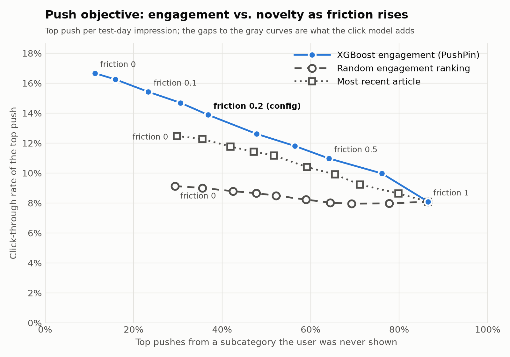
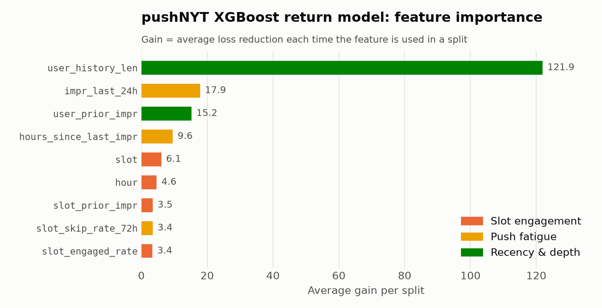
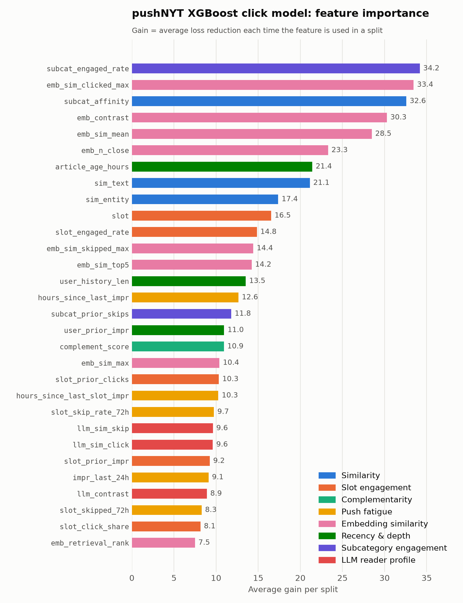
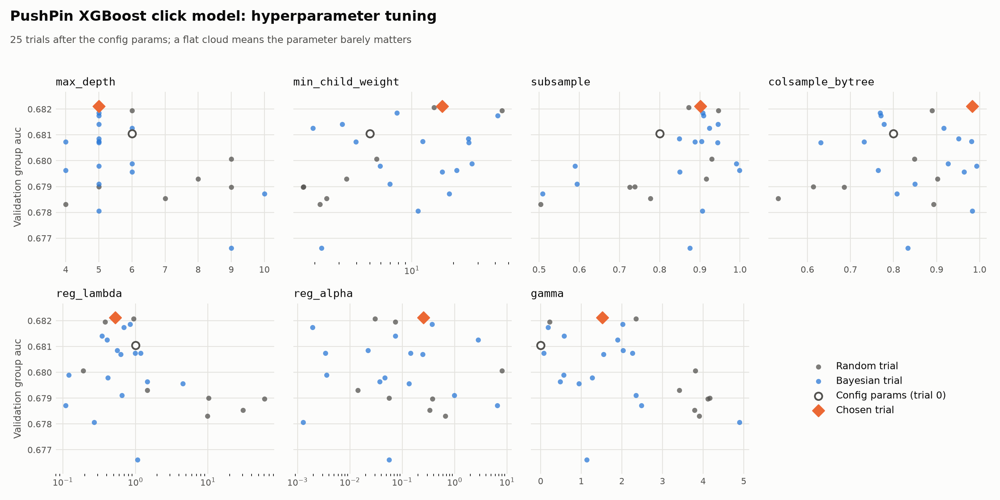

# Analysis: objective, calibration, send policy, the bandit's objective, user behavior, tuning

Deep dives behind the numbers in the [README](../README.md). Images are produced by `src/pushpin/plots.py`.

## Push objective

The click model answers "will they click?"; the push objective decides what to actually send.
For each candidate in an impression:

```
score = (1 − friction) · engagement + friction · novelty,     friction ∈ [0, 1]
```

- **engagement** — the XGBoost `P(click)`.
- **novelty** — `1 − share of the user's earlier exposure in the candidate's subcategory`, where
  exposure is their pre-period history clicks plus every article shown in earlier impressions.
  1 = a subcategory they have never been shown; near 0 = what they are usually shown.

**Same scale.** `P(click)` sits near 0.04 while novelty spans 0–1, so each half is converted to
its **percentile rank within the impression**. Friction is then a literal weight between two
rankings, unaffected by recalibrating `P(click)`.

**Baseline click rates.** Clicks are rare. On the test day (30,270 impressions, 1.22M candidates):

| What | Click rate |
|------|------------|
| Any single candidate shown | 3.8% |
| One candidate picked at random from each impression | 9.1% |
| The most recent candidate in each impression | 12.5% |
| The model's top pick per impression (friction 0) | 16.7% |

MIND only logs impressions with a click, so 9.1% (a random pick per impression) is the fair
baseline, and the model nearly doubles it. The newest candidate in each feed (smallest
`article_age_hours`) is a tougher baseline at 12.5%: recency alone is nearly half the model's
gain over random. These are feed impressions, so real push click rates would be lower.

**The trade-off.** `pushpin-objective` sweeps friction: the top pick's click rate against its
share from a never-shown subcategory, with the click model (solid), a random ranking (dashed) and
newest-first (dotted) as engagement (`recency-depth-no-emb` model):



| Friction | CTR of top pick | …with random engagement | …with most-recent engagement | Top pick from a never-shown subcategory |
|----------|-----------------|-------------------------|------------------------------|-----------------------------------------|
| 0 | 16.7% | 9.1% | 12.5% | 11% |
| 0.1 | 15.4% | 8.8% | 11.8% | 23% |
| 0.2 (default) | 13.9% | 8.5% | 11.2% | 37% |
| 0.3 | 12.6% | 8.2% | 10.4% | 48% |
| 0.5 | 11.0% | 8.0% | 9.2% | 64% |
| 1 | 8.1% | 8.1% | 8.1% | 87% |

Low friction buys novelty cheaply: 0 → 0.2 more than triples the never-shown share for about 3
points of CTR. Above about 0.5 the model keeps less and less of its edge. CTR only credits logged
clicks, so it likely understates how novel pushes would do.

## Calibration

A ranking only needs scores in the right order. A **send/don't-send decision** needs them to be
right in absolute terms: of all pushes scored 0.10, about 10% should be clicked. That property is
calibration, and models trained for ranking often lack it (gradient boosting with early stopping
tends to be over- or under-confident in the tails).

`pushpin-train` applies **Platt scaling**: it fits `p = sigmoid(a · logit(raw) + b)` on the
held-out early-stopping slice and applies it to the test day. The mapping is strictly increasing,
so rankings, AUC, and the push objective's choices are unchanged; only the probability scale
moves. (Isotonic regression is the more flexible alternative, but it creates ties, which would
change the objective's rankings.)


| | Raw XGBoost | Calibrated |
|---|---|---|
| Expected calibration error (ECE) | 0.35 pts | **0.24 pts** |
| Brier score | 0.03635 | **0.03630** |
| Top bin: predicted → observed | 13.2% → 10.9% | **11.1% → 10.9%** |

On average the raw model was already close; the fix matters at the top, where it was
**overconfident**, and the top is exactly where a send threshold operates. ECE is the
count-weighted mean gap between predicted and observed rates over 20 equal-count bins.

**MIND caveats.** Calibration is per *candidate*, not per chosen push, and MIND only logs
impressions that contain a click. Small impressions therefore have inflated click rates (18.6%
with ≤10 candidates vs 1.9% with >100), and the model can't see impression size. The labels also
mean "picked from this list", not "wants this article": candidates shown together compete for
about one click. So the 0.07 send threshold is in feed units (a top pick from about 37
candidates), not the chance of opening a lone notification. The send policy is evaluated on
impressions with 50+ candidates, where the artifact is weakest. Within those, top picks still
click more as the prediction rises (3.6% → 8.5% across quintiles), but the model over-predicts the
level. Two possible fixes are an impression-size feature fixed at a reference value at push time,
or weighting each impression once. Real push logs are the proper source (see
[Production](#production-plugging-in-real-opt-out-data) and
[Real pushes to your phone](notifier.md)).

## Return model (churn proxy)

The real cost of a bad push is a reader turning notifications off. MIND has no opt-out events, so
`pushpin-train` fits a proxy: **P(the user has another impression within 24 hours)**, an XGBoost
model on user depth and fatigue features (`src/pushpin/risk.py`). Risk = 1 − P(return).

- Labels are censored near the end of the log, so it trains on impressions before `fit_end`,
  is evaluated on `[fit_end, train_end)` (**AUC 0.743**, 54% return rate), and only scores the test day.
- It is a **user-level** signal: it mostly measures how active someone is, not what a push did to
  them. Subtracting it from the per-article score would barely change which article wins (it is
  nearly constant within an impression), so it sets **how much** to send each user, not **what**.
- The feature importances confirm it: a split on `user_history_len` (pre-log click count) reduces
  the loss about 7× as much as a split on any other feature, followed by recent activity
  (`impr_last_24h`, `user_prior_impr`, `hours_since_last_impr`). The engagement and skip-rate
  features add little.



## Send policy

For each impression's top pick (at the configured friction), `pushpin-objective` sends it only if

```
calibrated P(click) ≥ threshold + risk_penalty · (1 − P(return))
```

and the user has had fewer than `daily_cap` pushes that day (earliest first; the policy can't see
later impressions). Defaults in `configs/objective.yml`: threshold 0.07, risk penalty 0.04, cap 2.
At-risk users therefore only get pushes the model is more confident about.


On impressions with 50+ candidates:

| Threshold | Pushes per active user-day | CTR of pushes sent | Predicted CTR |
|-----------|----------------------------|--------------------|---------------|
| 0 (send all, cap 2) | 1.15 | 5.3% | 8.1% |
| 0.05 | 0.72 | 6.4% | 9.4% |
| **0.07 (default)** | **0.41** | **7.9%** | 10.9% |
| 0.10 | 0.14 | 10.3% | 13.9% |
| 0.15 | 0.02 | 17.4% | 19.1% |

Raising the threshold trades volume for quality as intended. At the default, low-risk users get
0.82 pushes/day at 9.3% CTR and high-risk users 0.15/day at 5.3%. The model over-predicts
on this slice, most for high-risk users, which is the impression-size caveat above plus a sign
that a production calibrator should be fit per user segment.

## Send decision: the contextual bandit's objective

The fixed send policy above is being replaced by a contextual bandit (simulation only so far;
full write-up and results in [bandit.md](bandit.md)). XGBoost still picks the article. The bandit
decides, for that pick, whether to send it now.

**The objective.** Maximize the expected total reward over all readers and slots:

```
maximize  E[ Σ over readers r and slots t of  reward(r, t) ]

reward(r, t) = session(r, t) − λ · send(r, t) − V · optout(r, t)
```

- `session` = 1 if the reader comes back in that slot's window, whether or not a push was sent.
- `send` = 1 if a push went out. λ is the cost of one push, in sessions (default 0.04: a push
  must cause at least 1 extra visit per 25 sends).
- `optout` = 1 if the reader turned notifications off then. V is the cost of losing them, in
  sessions (default 5: about 180 days × ~1 push a day × ~0.03 net per push).

λ and V are prices set by hand, not learned; results are reported across
λ ∈ {0.02, 0.04, 0.08} × V ∈ {2, 5, 20}.

**The model.** For each decision with context z (`p_click`, risk = 1 − `p_return`, their
product, recent pushes, pushes ignored this week, log hours since the last open, the reader's
open rate on our pushes, and whether this is their hour), a Bayesian linear regression:

```
reward − ŷ0  =  β · z  +  send · (θ · z)  +  noise,     noise ~ N(0, σ²),  (β, θ) ~ N(0, τ0² I)
```

ŷ0 is the reader's own organic session rate at that hour, estimated from slots without a push.
Subtracting it leaves the model only what a push adds. θ · z is the **effect of sending**: the
expected change in reward from sending rather than skipping.

**The decision rule (Thompson sampling).** Once per reader-day, draw θ̃ from the posterior and

```
send  if  θ̃ · z > 0
```

The posterior is refit every night from all decisions so far (σ = 0.4, τ0 = 1). XGBoost can be retrained the same night, first; see [bandit.md](bandit.md#operating-it). Drawing θ̃
rather than using its mean is the exploration: uncertain weights sometimes say "send", which
gathers the data that resolves them.

**As a threshold.** Because z contains `p_click`, alone and times risk, the rule rearranges into a
threshold on `p_click` that moves with context:

```
send  if  p_click ≥ threshold(z) = − θ̃_rest · z_rest / (θ̃_pclick + θ̃_pclick×risk · risk)
```

where `θ̃_rest · z_rest` is the sum over every other feature. It reads as a threshold only when
the denominator is positive, i.e. a more appealing pick makes sending better for that reader.
Compared with the fixed rule `0.07 + 0.04 · (1 − p_return)`:
- the risk term's size and sign are learned, not fixed at +0.04;
- the bar rises after recent and ignored pushes;
- it falls at the reader's own best hours;
- there is no daily cap: the weights on recent and ignored pushes take its place.

## Production: plugging in real opt-out data

In production the return proxy should be replaced by a model of actual notification opt-outs.
What NYT would need to log:

| Event | Fields | Used for |
|-------|--------|----------|
| Push sent | user, article, time, slot, model scores, **send probability** | Training data; off-policy evaluation of new policies |
| Push opened | user, article, time | The click label (replaces MIND impressions) |
| Push dismissed | user, article, time | Article-level negative feedback |
| Notifications disabled / app uninstalled | user, time, pushes in the prior 7 days | The opt-out model's label |

A user-level opt-out model drops straight into the send policy in place of `p_return`. Dismissals
and opt-outs shortly after a specific push are what an **article-level** risk term would need,
added to the score as `(1 − f) · engagement + f · novelty − λ · risk`; MIND has nothing comparable,
so that term is not built here.
The same logs would also give the contextual bandit its starting state and prior
([bandit.md](bandit.md#operating-it)).

## Do clicks on unfamiliar subcategories stick?

The novelty term pays a click cost now on the bet that new interests last. MIND can partly test
that bet. `pushpin-exploration` takes each user's **first exposure** in the log to each
subcategory, notes whether they clicked it and how unfamiliar it was at that moment, and then asks:
among users shown that subcategory again later, what share click it?


| Subcategory at first exposure | Clicked the first time | Shown and skipped | Ratio |
|-------------------------------|------------------------|-------------------|-------|
| Never shown before | 17.6% | 7.4% | **2.4×** |
| Rarely shown (<10% of exposure) | 32.9% | 22.7% | 1.5× |
| Familiar | 51.7% | 36.4% | 1.4× |

(First exposures with at least 48h of log left; 20k–380k re-exposed users per bar; 95% CIs ≤ ±1 point.)

Users come back to familiar subcategories far more often, as expected. But a first click on a
**never-shown** subcategory goes with a 2.4× higher chance of clicking it again, the biggest
relative gap of the three: an unfamiliar click that lands is followed by real, repeated interest,
not just a one-off. That supports the novelty term's premise.

**Caveats.** This is observational and on feed clicks, not pushes: users who click unfamiliar
topics may simply be more curious, so it shows association, not that a push *creates* interest.
The follow-up is at most a few days, and a user can only re-click what the feed showed them again
(hence conditioning on re-exposure). The causal version is an experiment: randomize friction and
measure later organic reading of the new subcategories.

```bash
docker compose run --rm train "pushpin-exploration"   # writes outputs/analysis/exploration.{csv,png}
```

## Fatigue: do users engage less after heavy exposure?

The send policy's daily cap assumes more pushes means less attention to each. `pushpin-fatigue`
checks what MIND shows. Heavy users differ from light ones, so each user is compared with **their
own** usual engagement: for every impression, expected clicks = impression size × the click rate
for impressions of that size (MIND's logging inflates small ones), scaled by the user's own
actual-to-expected ratio. The index is actual ÷ expected clicks: 1.00 = usual, below = fatigued.
Users with 5+ impressions (9,725); 95% CIs resample users.


Engagement vs. a user's usual, by impressions in the previous 24 h: **1.019** (none), 0.994 (1),
0.997 (2), 0.991 (3–4), **0.983** (5+). By impressions earlier in the week: 1.016 (none), 0.994
(1–2), 0.997 (3–5), 1.000 (6–10), 1.008 (11+).

- **Short-term fatigue is real but small.** Users engage about 2% above their norm when they have
  not been seen in the past day and about 2% below it after 5+ impressions; the intervals at the
  two ends don't overlap. Freshness matters: the first impression after a gap does best.
- **No cumulative fatigue over the week.** Engagement does not keep falling with total exposure; the
  heaviest users are back at their norm, likely because people who keep coming back are the
  engaged ones.
- **What it supports:** a *daily* cap and spacing pushes out (both in the send policy and the
  `hours_since_last_impr` feature), rather than a weekly budget.

**Caveats.** Feed impressions are started by the user, while pushes arrive unprompted, so push
fatigue is very likely stronger than this, and MIND can't show the outcome that matters most:
users turning notifications off. Six days is also short for "long term." The production version is
the volume experiment in the roadmap: randomize daily caps for several weeks and track CTR and
opt-outs over time.

```bash
docker compose run --rm train "pushpin-fatigue"       # writes outputs/analysis/fatigue.{csv,png}
```

## LLM reader profiles

The click/skip contrast features compare a candidate with the user's own clicked and skipped
articles. The LLM profile asks whether an LLM, given the same evidence, captures *why* a reader
clicks one article and passes over a similar one better than the raw nearest neighbors do.

- **Retrieve.** For day D: the user's 10 most recent clicks before D, and for each, the 2
  nearest skipped articles from their earlier impressions. Skips they later clicked are dropped.
  Skips close to a click show within-topic preferences that subcategory counts can't.
- **Generate.** One request per user-day to `claude-haiku-5-5` through the Message Batches API
  (half price). The structured output is `{click_themes, skip_themes}`, 2-4 each. Themes read
  like headlines ("NFL game recaps, injuries and trade rumors"), so they embed near abstracts.
  Each set describes only itself, because MiniLM ignores "rather than"; the comparison is left to
  `llm_contrast`.
- **Embed and score.** Each theme is its own vector in the `profiles` Chroma collection, and a
  candidate is scored by its best-matching theme. Users with no clicks or no skips have missing
  features, which XGBoost handles.

Profiles only use data from before their day (about 41k user-days in MIND-small). Batch ids per
prompt version are in `data/llm/batches.json` (reruns resume), costs in `data/llm/report.json`,
and training memory-maps the theme vectors from `data/llm/theme_vectors_{click,skip}.npy`.

To measure the uplift, train with and without the three `llm_*` features, then compare the two
runs on the same test impressions (results below):

```bash
docker compose run --rm train "pushpin-train --exclude llm_sim_click llm_sim_skip llm_contrast --output-dir outputs/ablation-no-llm"
docker compose run --rm train "pushpin-train --output-dir outputs/ablation-with-llm"
docker compose run --rm train "pushpin-compare outputs/ablation-no-llm outputs/ablation-with-llm"
```

`pushpin-compare` prints the paired difference and writes it to
`outputs/ablation-with-llm/compare_vs_ablation-no-llm.json`.

### Results

Test day 2019-11-14, all features, with and without the three `llm_*` features: AUC 0.7026 →
0.7032, group AUC 0.6757 → 0.6766, log loss unchanged (0.1520). The separate CIs overlap, but most
of their width is test-set noise the runs share, so `pushpin-compare` scores both on the same
resampled impressions (1,000 paired replicates):

| Metric | With − without | 95% CI | P(no gain) |
|--------|----------------|--------|------------|
| AUC | +0.0006 | −0.0000 to +0.0013 | 0.027 |
| Group AUC | +0.0009 | −0.0003 to +0.0021 | 0.082 |

The LLM themes add at most about a thousandth of AUC: borderline for AUC, not significant for
group AUC. They rank 23rd, 24th and 27th of 30 by gain, well behind `emb_sim_clicked_max` and
`emb_contrast`, which use the same clicked/skipped evidence. One training seed each, so the CI
covers test-set sampling but not run-to-run variance. Feature importance (`ablation-with-llm`):



## Hyperparameter tuning

The click model's XGBoost settings (`model` in `configs/train.yml`) were reasonable defaults,
never searched. Tuning asks whether different settings rank clicks better. It is off by default;
`pushpin-train --tune 25` runs it before the final fit (`src/pushpin/tuning.py`).

**What is searched.** Seven parameters, each over a range in `tuning.space`:

| Parameter | Range | Scale | Controls |
|-----------|-------|-------|----------|
| `max_depth` | 4–10 | integer | How many feature interactions one tree can capture |
| `min_child_weight` | 1–50 | log | Minimum evidence in a leaf; higher = more conservative |
| `subsample` | 0.5–1.0 | linear | Share of rows each tree sees |
| `colsample_bytree` | 0.5–1.0 | linear | Share of features each tree sees |
| `reg_lambda` | 0.1–100 | log | L2 penalty on leaf weights |
| `reg_alpha` | 0.001–10 | log | L1 penalty on leaf weights |
| `gamma` | 0–5 | linear | Minimum loss reduction needed to split |

Log scales are for parameters whose effect scales by orders of magnitude, so 1 to 5 gets as
much attention as 10 to 50. `learning_rate` stays at 0.05 (a lower rate mostly trades time for a
little accuracy), and early stopping picks the number of trees in each trial.

**How each trial is scored.** Features are built once. Each trial refits XGBoost on the fit slice,
early-stops on the validation slice (the latest 20% of the training day), and is scored by
**group AUC** on that slice, since the push objective ranks candidates within an impression.
The test day is never seen during the search, so its AUC stays an honest estimate.

**The search: Bayesian optimization** (a Gaussian process with expected improvement, GP-EI;
Snoek, Larochelle & Adams 2012). Trial 0 is the config's own params; trials 1–8 are random draws;
each later trial fits a GP to all trials so far and goes where the expected improvement over the
best score is highest, either because the GP predicts a high score there or because it's still
unsure. Unlike random search, earlier trials aim later ones. **The winner** is the trial with the
highest score *predicted* by a final GP, not the highest observed one: trials differ by about a
thousandth of AUC, so the observed best is partly luck. The GP's per-parameter **length scales**
show which parameters matter (a value at the upper bound, 100, means no effect); `tuning.png`
shows the same visually. **No cross-validation:** random folds would train on later hours to
predict earlier ones, and rolling time folds need more history than MIND-small's six days.

**Caveat.** The validation slice now does three jobs: early stopping, Platt calibration and model
selection. Validation scores of the chosen trial are therefore slightly optimistic. Only the
test-day comparison counts as evidence of a gain.

To run it and compare against the untuned model on the same test impressions:

```bash
docker compose run --rm train "pushpin-train --tune 25 --output-dir outputs/tuned"
docker compose run --rm train "pushpin-compare outputs/ablation-with-llm outputs/tuned"
```

Outputs: `tuning.csv` (every trial), `tuning.png`, `metrics.json → tuning`, and `config.yml`
with the chosen params and `tuning.trials: 0`, so a rerun reproduces the model without searching.

### Results

One 25-trial Bayesian run (`outputs/tuned`), 16 minutes of search. It picked trial 17 (validation
group AUC 0.6810 → 0.6821, 438 → 589 trees); the chosen values are in the
[regularization table](model.md#regularization). The changes go both ways (a weaker L2 penalty and less sampling, but shallower trees, `gamma`
pruning and larger leaves): fewer, sturdier splits with less-shrunk leaf weights
([model.md](model.md#regularization) labels each control).

**Test day.** Paired against the untuned model (`ablation-with-llm`) on the same test
impressions (1,000 paired replicates, 30,270 impressions):

| Metric | Untuned | Tuned | Tuned − untuned | 95% CI | P(no gain) |
|--------|---------|-------|-----------------|--------|------------|
| AUC | 0.7032 | 0.7041 | +0.0009 | +0.0004 to +0.0014 | <0.001 |
| Group AUC | 0.6766 | 0.6780 | +0.0014 | +0.0003 to +0.0025 | 0.004 |

Log loss is unchanged (0.152). The validation gain carried over to the test day, so the search
didn't just fit validation noise. The gain is small, about the LLM features' size, but both
paired CIs exclude zero (one seed each, so run-to-run variance isn't covered).

**What mattered:** `subsample`, `reg_lambda`, `max_depth` and `gamma` (short GP length scales);
the other three had no effect. Deep trees (8–10), `subsample` below 0.8 and heavy `reg_lambda` or
`gamma` hurt.



**Limitation.** The final GP fit an almost-zero noise term, so "highest predicted" equaled
"highest observed" and gave no protection against a lucky trial (the test-day gain suggests it
wasn't luck). Setting the GP's noise floor from a few repeated seeds would fix it.

The tuned run has not been promoted: the live scorer and the README numbers still use
`ablation-with-llm`.
