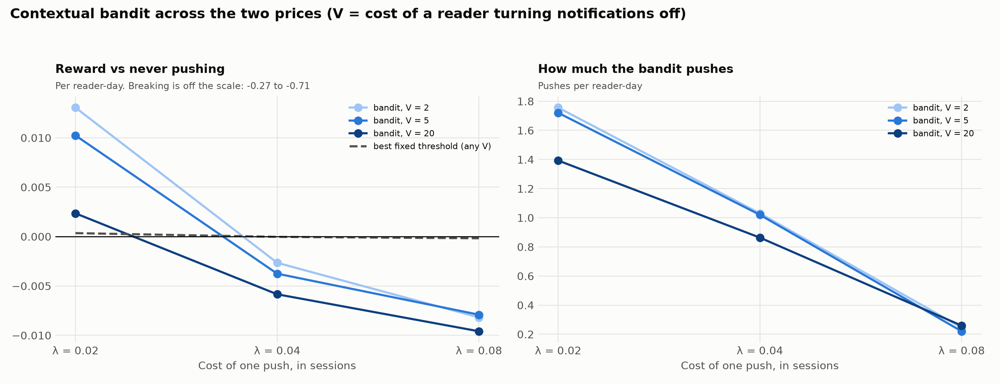
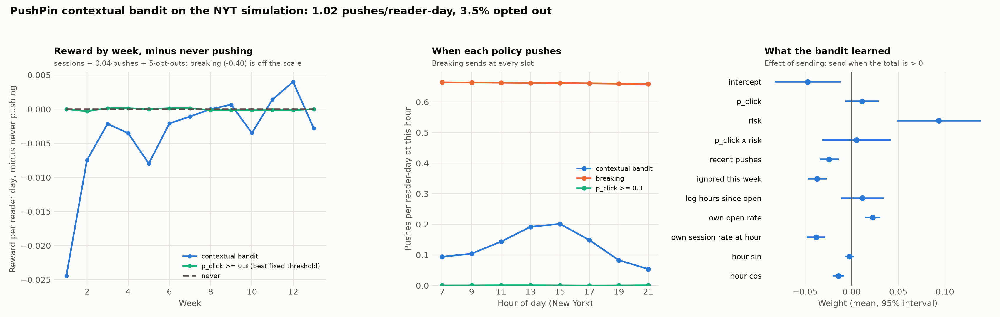

# Contextual bandit: when to push

XGBoost picks **which article** each reader gets. The bandit decides **whether to push it now**,
instead of the fixed rule (`p_click ≥ 0.07 + 0.04 × (1 − p_return)`, at most 2 a day), learning
from what pushes actually did. It's tested here on the NYT simulation against pushing the latest
breaking story at every slot. **Status:** simulation only; live still uses the fixed rule. The
model's formulas are in [analysis.md](analysis.md#send-decision-the-contextual-bandits-objective).

Code: `src/pushpin/bandit.py`, `configs/bandit.yml`, `tests/test_bandit.py`. Plots:
`docs/bandit.png`, `docs/bandit_grid.png`.

## Contents

- [Two models, two jobs](#two-models-two-jobs)
- [The reward and its two prices](#the-reward-and-its-two-prices)
- [The bandit](#the-bandit)
- [The planted world](#the-planted-world)
- [Results](#results)
- [What it learned](#what-it-learned)
- [Operating it](#operating-it)
- [With much more data](#with-much-more-data)
- [Limitations](#limitations)
- [Running it](#running-it)

## Two models, two jobs

XGBoost learns **what a reader likes** from millions of MIND impressions. The bandit learns **how
they respond to being pushed** from its own send decisions. It gets XGBoost's outputs (`p_click`,
`1 − p_return`) and context about our pushes, but no article features, and XGBoost never sees
what a push did (the no-push outcome, annoyance, opt-outs). XGBoost's few fatigue features
(`slot_skipped_72h`, `impr_last_24h`, ...) come from feed visits readers chose to make, and their
effect is small (about 2%; [analysis.md](analysis.md)).

**Why not one bandit on all the features?**
1. **Far too little data, too much exploration.** The bandit sees one decision per reader per
   slot, about 5% opened. Thompson sampling must explore to learn each weight: manageable with 9
   inputs, far longer with hundreds, and that exploration is real readers getting pushes that
   don't help them.
2. **It doesn't rank.** It decides send or skip for one pick; XGBoost chooses that pick from
   ~100 candidates. Choosing articles too is a much harder problem ([below](#with-much-more-data)).
3. **No friction knob.** The push objective sets engagement vs. novelty explicitly (friction
   0.2); a bandit maximizing visits would set it implicitly.

The cost: two picks with the same `p_click` look alike to the bandit, even if one is a close
topic match and the other broadly popular. With more data, scores like topic match or novelty
can be added to its context one at a time, and at scale an uplift model trained offline on all
the features ([uplift.md](uplift.md)) can pass its estimate of a push's effect as one more input.

## The reward and its two prices

```
reward = session − λ × push − V × opt-out          (per reader-slot)
```

A **session** is a return visit: the reader coming back in that slot's window by any route,
counted whether or not a push was sent. **Opens aren't rewarded**: an open by a reader who'd have
come anyway adds nothing. They matter through annoyance (ignored pushes) and as an input. How much
one push raises visits or opens isn't known from any data here, so the simulation plants it.

Both prices are **set by hand**, in sessions:
- **λ, the cost of one push:** 0.04 = a push must cause one extra visit per 25 sends.
- **V, the cost of a reader turning notifications off:** what their future pushes would have
  caused, ≈ 180 days × ~1 push a day × ~0.03 net ≈ 5.

Results are reported across λ ∈ {0.02, 0.04, 0.08} × V ∈ {2, 5, 20}.

## The bandit

At every slot the candidate is XGBoost's top unpushed article, and the bandit decides from a
context z:

| Input | Why |
|---|---|
| `p_click`, risk (`1 − p_return`), their product | XGBoost's outputs, as summaries |
| recent pushes (last 4 hours), pushes ignored this week | fatigue, annoyance |
| log hours since the last open; the reader's open rate on our pushes | how they respond to *us* |
| is this their hour: organic session rate at this hour ÷ their own average, from slots without a push | personal timing, separate from how often they come back at all |

A Bayesian linear regression on `[z, send × z]` estimates θ, the **effect of sending**.
**Thompson sampling** draws θ once per reader-day and sends when θ · z > 0. The posterior is refit
every night from all decisions so far. Because z contains `p_click`, the rule is a threshold on
`p_click` that moves with context.

Two design fixes came from the results:
- **No clock-time feature.** Hour of day as a sine/cosine pair can draw only one bump per day.
  With the true average effect flat across hours, it put pushes at midday on noise.
- **Learn on reward minus the reader's organic rate at that hour.** The organic baseline is
  really `p_return × preference`; a linear model misfits it, and because sends aren't random the
  misfit leaked into θ. The bandit learned to push *away* from readers' best hours, where the
  true effect is 2× larger. Subtracting the baseline fixed it.

## The planted world

There are no real no-push outcomes ([uplift.md](uplift.md#live-data)), so outcomes are planted
on real candidates: the 8-slot NYT simulation (`outputs/nyt-sim-8slot`: 1,000 MIND readers, slots
every two hours from 7 to 21, each reader's top 20 candidates plus the slot's newest article),
replayed for 13 weeks with fresh draws and carried-over reader state. Per slot
(values in `configs/bandit.yml`):

```
organic return  y0  = organic × p_return × pref(hour)
push effect     tau = lift × (1 − p_return) × interest × pref(hour) × exp(−annoyance / tolerance)
                      − fatigue × recent pushes
opened          P   = p_click × pref(hour) × exp(−annoyance / tolerance)
opt-out         P   = hazard × ((1 − p_return) / mean) × annoyance / tolerance   (after an ignored push)
```

Annoyance rises by 1 per ignored push and halves every 3 days. Tolerance varies by reader and is
higher for readers who click more. Each reader prefers morning, midday or evening. **Risk cuts
both ways:** at-risk readers gain the most from a good push and quit the most easily when
annoyed. Every policy sees the same random draws (common random numbers).

## Results

| Policy | Rule |
|---|---|
| **Contextual bandit** | as above |
| **Breaking** | the newest article to every reader at every slot (8 a day, no model) |
| **Best fixed threshold** | `send if p_click ≥ c`, best of c ∈ {0.04, …, 0.30} *in hindsight* |
| **Never** | the floor (1.169 organic visits per reader-day) |



Reward relative to never pushing, per reader-day, over 13 weeks:

| λ | V | Bandit | Pushes/day | Opted out | Best threshold (c) | Breaking |
|---|---|---|---|---|---|---|
| 0.02 | 2 | **+0.0130** | 1.60 | 5.3% | +0.0003 (0.2) | −0.27 |
| 0.02 | 5 | **+0.0160** | 1.47 | 4.5% | +0.0003 (0.2) | −0.29 |
| 0.02 | 20 | **+0.0107** | 1.22 | 3.9% | +0.0003 (0.2) | −0.39 |
| 0.04 | 2 | **+0.0018** | 0.86 | 2.9% | −0.0000 (0.3) | −0.38 |
| 0.04 | 5 | **+0.0074** | 1.00 | 3.3% | −0.0000 (0.3) | −0.40 |
| 0.04 | 20 | **+0.0042** | 0.83 | 3.5% | −0.0000 (0.3) | −0.50 |
| 0.08 | 2 | −0.0060 | 0.52 | 1.3% | −0.0002 (0.3) | −0.59 |
| 0.08 | 5 | −0.0077 | 0.55 | 1.3% | −0.0002 (0.3) | −0.61 |
| 0.08 | 20 | −0.0039 | 0.47 | 0.8% | −0.0002 (0.3) | −0.71 |

- **Breaking is far worse everywhere.** Over 99% of its pushes are ignored; visits fall below
  never pushing and 59% of readers opt out.
- **At λ = 0.02–0.04 the bandit is the only policy that gains**, +0.002 to +0.016 (about 3–4%
  more return visits, 0.2–1.4% net of costs), while the best fixed threshold gets ~0.
- **At λ = 0.08 pushing doesn't pay in this world.** A very high threshold (almost never push)
  gets there; the bandit pushes ~0.5 a day and ends slightly below never.
- **It reacts to the prices in the right direction** (fewer pushes as λ or V rises) and learns
  within weeks: at λ = 0.04, V = 5 it's ahead of never pushing from week 3 on.

## What it learned



Weights on the effect of sending, at λ = 0.04, V = 5:

- **Risk +0.043, `p_click × risk` +0.048: fewer, better pushes for readers at risk of leaving.**
  Their bar drops mainly for appealing picks and rises after ignored or recent pushes. The old
  rule only protected them (`+0.04 × risk` on the bar), giving up the gain. The real balance
  depends on numbers the sim only plants.
- **Push history:** recent pushes −0.044, ignored this week −0.027, own open rate +0.011.
- **Is this their hour: +0.006 (± 0.001).** 28% of decisions at a reader's best hours are sends,
  vs 5% at their worst. With the 4-hour fatigue window, a push at 7 makes 9 costly, so pushes per
  hour alternate.
- **`p_click` alone: −0.017 (± 0.012), uncertain.** Its effect comes through the interaction
  with risk.

## Operating it

- **Editorial alerts.** `editorial` in `configs/bandit.yml` lists must-send news_ids. At the
  slot where one is newest it goes to every subscribed reader, bypassing every policy, and counts
  as a push. Off in the results above. In a demo with two of the week's biggest stories (the
  fall of Assad, South Korea's martial-law aftermath), the bandit barely cut its own pushes, so
  opt-outs rose from 3.3% to 5.6%. The sim treats an alert like any push (real breaking news is
  probably opened far more), and the bandit reacts to alerts only afterwards; a production
  version would reserve an editorial budget. Live, alerts would be logged with propensity 1.
- **Retraining each night.** Retrain XGBoost first, on MIND plus the push logs; then refit the
  bandit on all its decisions. A retrain shifts the `p_click` / `p_return` the bandit sees, so log
  the model version with every decision.
- **Starting from a publisher's push history.** Topics of opened pushes feed XGBoost. A reader's
  open, ignore and timing history fills the bandit's inputs from day one. Past pushes and their
  outcomes give the **prior** on the weights: fit the same regression on the logs and start from
  θ ~ N(θ_logs, c · Σ_logs) with c > 1 instead of N(0, τ0² I), widening the uncertainty because
  editorial blasts say little about per-reader differences. Readers' own notification settings
  are hard rules, not something to learn.

## With much more data

1. **Choose the article too:** one action per candidate plus skip. The bandit then absorbs
   XGBoost's and the uplift model's jobs (usually a neural network with an ensemble for the
   uncertainty, after a cheap retrieval step narrows the candidates; e.g. YouTube, Chen et al.
   2019).
2. **Plan over the day** (reinforcement learning): skip's value includes the best that can happen
   later, so "save this story for the reader's evening peak" falls out of the value of skipping.
3. **Cheap middle ground, one-step lookahead:** send only if now beats the reader's best
   remaining slot today, using the same model. It would mainly fix pushes going out early.

Each step trades simplicity for power, so the current split is the right shape until the data
exists.

## Limitations

- **Planted outcomes.** Set before the results and not tuned afterwards, but the answer depends
  on them, not on real readers.
- **Carryover isn't credited.** A decision's reward is its own slot. An ignored push's later cost
  (lower effects and opens for days) isn't charged to it, which is the likely reason it
  over-pushes at λ = 0.08. A 24-hour reward window would be little code, but it makes learning
  noisier (a skip shares credit for later pushes, and each reward carries a day of random
  visits), so it wasn't added.
- **No positive spillover is planted.** An opened push never makes a reader more likely to come
  back later. The evaluation counts every slot and would capture it, so the gains may be
  conservative.
- **Exploration cost**, visible over 13 weeks with 1,000 readers.
- **Linear in z**, and the organic baseline is the bandit's own estimate, noisy for new readers.
- **Live needs an outcome without a push:** per-reader delivery and an observable visit; see
  [uplift.md](uplift.md#live-data).

## Running it

```bash
uv run pushpin-bandit            # one comparison at λ = 0.04, V = 5 (a few seconds)
uv run pushpin-bandit --grid     # plus every (λ, V) in the grid
```

It needs `outputs/nyt-sim-8slot` from the push job:

```bash
docker compose up -d scorer
docker compose run --rm --no-deps push-job "pushpin-push-job --scorer http://scorer:8000 \
  --slot-hours 7,9,11,13,15,17,19,21 --day-pool --keep-top 20 --out outputs/nyt-sim-8slot"
```

Outputs go to `outputs/bandit/`: `summary.json`, `policies.csv`, `weekly.csv`, `hours.csv`,
`coefficients.csv`, `bandit.png`, and with `--grid`, `grid.csv` and `bandit_grid.png`.
