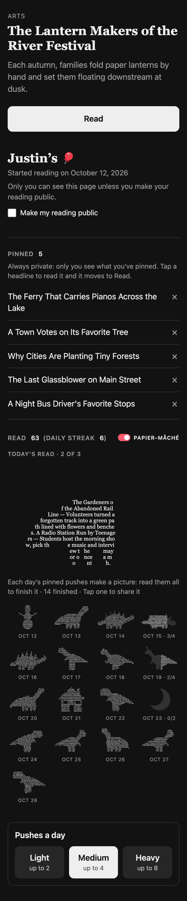

# What the phone shows

Screens from the web version of PushPin (ntfy push → card server pages) at iPhone width. The pages
are real screenshots of the card server; the lock screen is a mockup built from a real push sent on
November 13, 2026. The flow is: Push -> Pin (which happens just by clicking the push) -> Read (which has papier-mâché mode).

## 1. A push arrives

The PushPin icon, the headline as the title and the abstract as the body.

*Mockup: how iOS draws a notification depends on the ntfy app and the phone's settings.*

## 2. Pinning the push

Tapping a push opens `/p/<push_id>`, which records the open (the click the model learns from) and
shows the article pinned on top of the reader's profile. **Read** opens it on nytimes.com. Below
are **Pinned** (tapped but not read yet, always private), **Read** with the count, daily streak and
the day's pictures (section 3), and pushes a day. This sample reader, set up on a copy of the
database, has read 6 of the 10 pushes they opened that day.

## 3. The demo profile

`/demo` is a made-up Medium reader (4 pushes a day): 63 reads over 18 days, with invented titles
and abstracts. It stores nothing.

`/demo/me` is the same reader's own view, as if they'd just tapped today's third push: it's pinned
on top with Read, then the privacy switch, Pinned (pushes tapped but not read yet), Read with the
pictures, and pushes a day. Its buttons only change the page; × takes an article out of its day's
count and the pictures redraw.

Each day you pin pushes (tap them) makes one papier-mâché picture, a common symbol (snowman,
heart, star, moon...) or a dinosaur, the same shape for everyone that day, written in the titles
and abstracts of the ones you read, each used once. It fills in as you read what you pinned: 3
read and 2 still pinned is 3/5, everything read is finished, and pushes you never tapped don't
count, and an article you delete with × leaves the count whether you read it or not (2 pinned and
3 read, one deleted: out of 4). While the day is on, nothing shows of the rest, so it's a guess
what it will be (today: Oct 29 · 2/3). Once the day is over, an unfinished picture gets the grey
outline of what it could have been under the part that was read (Oct 15 · 3/4), and a day with
things pinned but nothing read is just the outline (Oct 23 · 0/2). Today, with nothing read yet,
says "Start reading to make today's word art". The type is sized so the text fills the whole
shape, thin parts included. At the top of Read, in both the list and the pictures, Today's read
shows today's word art so far, bigger, with its count (Today's read · 2 of 3).

## 4. Sharing a picture

Tapping a picture makes it a sticker (an unfinished one from today shows just the part revealed so
far; one from a day that's over is the whole shape's die-cut, blank white where it was missed):
everything read that day, every title with its whole abstract, written into the shape on a white
die-cut with a soft shadow and the PushPin pin in the corner, as a PNG with a transparent
background. It looks the same in any chat, in light or dark mode, and the words make each one the
reader's own. **Share** opens the phone's share sheet with the image, **Copy** puts it on the
clipboard to paste into a message, and **Save** saves it (on a phone it opens the share sheet,
where Save Image puts it in Photos; a web page can't save to Photos directly).

The demo's snowman and Brontosaurus, each made of the four articles read that day:

Days that are over and weren't finished share what was missed: Oct 15 (3 of 4 pinned read) and
Oct 23 (2 pinned, nothing read):

Today's unfinished picture (Oct 29, 2 of 3 pinned read) shares just the part revealed so far:

## Before the first push: the welcome page

The welcome push opens `/start`, where the reader picks how many pushes a day, then goes on to the
profile.

## Regenerating these

Run a card server on a copy of the database, so a screenshot doesn't record a real open, and drive
headless Chrome over the DevTools protocol: device metrics 390 × 844 at 2x with `mobile: true`, dark
mode. For the share sheet, stub `navigator.canShare` and `navigator.share` (headless Chrome hides the
button without them) and click a `.papier button.dino`; the sticker is the dialog ``'s data URL.
