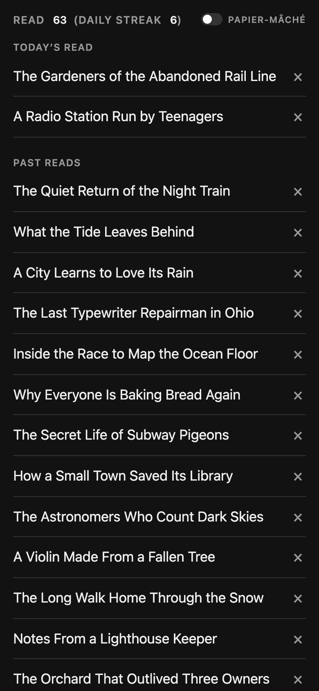

# What the phone shows

Screens from the web version of PushPin (ntfy push → card server pages) at iPhone width. The pages
are real screenshots of the card server; the lock screen is a mockup built from a real push sent on
November 13, 2026. The flow is: Push -> Pin (which happens just by clicking the push) -> Read (which has papier-mâché mode).

## 1. A push arrives

The PushPin icon, the headline as the title and the abstract as the body.

*Mockup: how iOS draws a notification depends on the ntfy app and the phone's settings.*

## 2. Pinning the push

Tapping a push opens `/p/<push_id>`, which records the open (the click the model learns from) and
shows the article pinned on top of the reader's profile. **Read** opens it on nytimes.com. Below
are **Pinned** (tapped but not read yet, always private), **Read** with the count, daily streak and
the day's pictures (section 3), and pushes a day. This sample reader, set up on a copy of the
database, has read 6 of the 10 pushes they opened that day.

## 3. The demo profile

`/demo` is a made-up Medium reader's public link: 63 reads over 18 days, with invented titles and
abstracts. `/demo/me` is the same reader's own view, as if they'd just tapped today's push: privacy
switch, Pinned, Read and pushes a day; its buttons only change the page. Neither stores anything.

With **Papier-mâché** on, the first 3 articles read each day (whenever they were pinned) make that
day's word art: a common symbol or a dinosaur, taking turns, the same shape for everyone that day,
written in the articles' titles and abstracts. It fills in 1/3, 2/3, then it's finished; later
reads are listed but don't change it, and × on a read article takes it out. **Today's read** is on
top (Today's read · 2 of 3), then past days. Today's unread part stays hidden; a past day that
stopped short shows the rest as a grey outline (Oct 19 · 2/3). With Papier-mâché off, Read is just
two lists: Today's read and Past reads.

## 4. Sharing a picture

Tapping a picture makes it a sticker: the words on a white die-cut of the shape, with the pin in the
corner, as a PNG that looks the same in any chat. **Share** opens the share sheet, **Copy** copies
the image, and **Save** saves it (on a phone, through the share sheet's Save Image, into Photos).
An unfinished past day is the whole die-cut, blank where it wasn't read; today's shows only the part
read so far.

## Before the first push: the welcome page

The welcome push opens `/start`, where the reader picks how many pushes a day, then goes on to the
profile.

## Regenerating these

Run a card server on a copy of the database, so a screenshot doesn't record a real open, and drive
headless Chrome over the DevTools protocol: device metrics 390 × 844 at 2x with `mobile: true`, dark
mode. For the share sheet, stub `navigator.canShare` and `navigator.share` (headless Chrome hides the
button without them) and click a `.papier button.dino`; the sticker is the dialog ``'s data URL.
