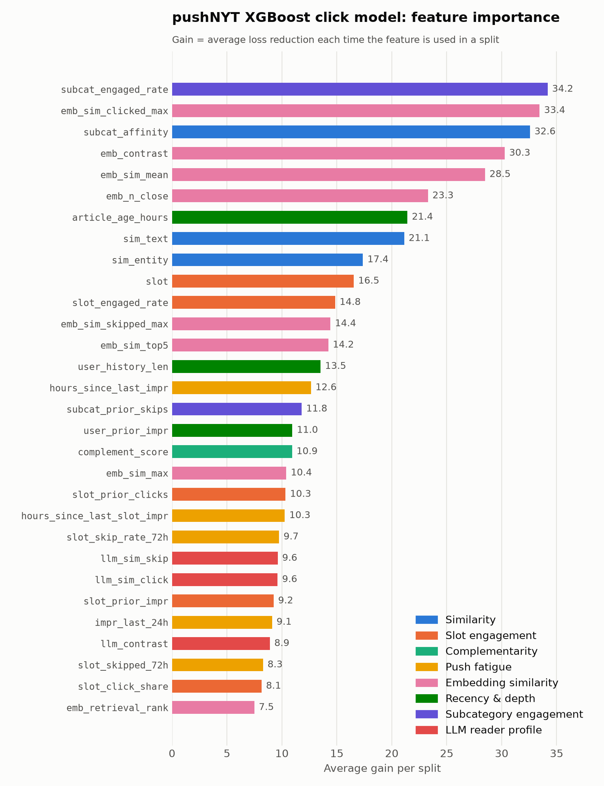

# Model, objective and results

How the click model, push objective and send policy are built and how they score. Short version in the [README](../README.md).

## Overview

PushPin predicts whether a reader will click on a given article if it is pushed to them in a
given time slot, `P(click | user, article, time slot)`. Slots are:

| Slot      | Hours (local) |
|-----------|---------------|
| morning   | 05:00–11:59   |
| afternoon | 12:00–16:59   |
| evening   | 17:00–04:59   |

The model is an XGBoost
classifier trained on the [Microsoft News Dataset (MIND)](https://msnews.github.io/), with
article abstracts embedded into a local [Chroma](https://www.trychroma.com/) vector database for
retrieval features and Claude-written reader profiles. A push objective and send policy on top
decide what to send and whether to send it. It can also send real pushes to your phone; see
[docs/notifier.md](notifier.md).

## Pipeline

```
gs://pushpin-data ──sync-data.sh──▶ data/
                                     │
          news.tsv ──pushpin-embed──▶ data/chroma   (MiniLM abstract embeddings)
                                     │
 behaviors.tsv + chroma ──pushpin-profile──▶ data/llm + chroma  (Claude click/skip themes per user-day)
                                     │
 behaviors.tsv + news.tsv + entity embeddings + chroma + profiles
                                     │
                              pushpin-train            (train container)
                                     │
                                     ▼
          outputs/<run>/  (click model + calibration, return model, metrics, predictions.parquet)
                                     │
                            pushpin-objective          (objective container)
                                     │
                                     ▼
          outputs/<run>/objective/  (engagement-vs-novelty tradeoff, send policy, chosen pushes)

          outputs/<run>/predictions.parquet ──▶ pushpin-api  (api container, :8000)
```

1. **Sync** — `scripts/sync-data.sh` pulls MIND from the project's GCS bucket.
2. **Embed** — `pushpin-embed` encodes each abstract (title if empty) with `all-MiniLM-L6-v2`
   into Chroma (`data/chroma`, collection `abstracts`).
3. **Profile** — `pushpin-profile` (RAG + LLM): for each user-day, retrieves recent clicks and the
   skipped articles nearest to each, and has Claude Haiku name 2-4 themes the user clicks and
   2-4 they skip (Message Batches API). Themes are embedded into a `profiles` collection.
4. **Train** — `pushpin-train` builds features, trains XGBoost with early stopping, calibrates it,
   fits a return model (churn proxy), and evaluates on a held-out day.
5. **Objective** — `pushpin-objective` picks one push per impression (engagement vs. novelty) and
   decides whether to send it. Its own lightweight image; no retraining needed to change it.
6. **Serve** — `pushpin-api` exposes scores and push decisions over HTTP.
7. **Analyze** — `pushpin-exploration` and `pushpin-fatigue` study behavior across the whole log.
8. **Decide when** — `pushpin-bandit`: a contextual bandit that learns the send decision from
   what pushes did (return visits, annoyance, opt-outs), tested on the NYT simulation; it would
   replace the fixed send policy. See [bandit.md](bandit.md).

**Time-based split.** Impressions before `split.fit_end` only fit complement statistics and user
history; `[fit_end, train_end)` trains (latest `model.valid_fraction` held out for early
stopping); `train_end` onward is test. Every per-user feature uses only strictly earlier impressions.

### Features

Defined in `src/pushpin/features.py`:

| Group | Features | Idea |
|-------|----------|------|
| Time-slot engagement | `slot`, `slot_prior_impr`, `slot_prior_clicks`, `slot_engaged_rate`, `slot_click_share` | Past engagement in this slot, shrunk toward the global rate |
| Similarity | `sim_text`, `sim_entity`, `subcat_affinity` | Candidate vs. history: TF-IDF/SVD text, TransE entities, subcategory mix |
| Complementarity | `complement_score` | Alibaba-style `s_ab = p_ab − q_ab` over subcategories ([background](https://eugeneyan.com/writing/push/)): what users read *next* |
| Push fatigue | `slot_skipped_72h`, `slot_skip_rate_72h`, `impr_last_24h`, `hours_since_last_impr`, `hours_since_last_slot_impr` | Recent skips and volume |
| Embedding retrieval | `emb_sim_mean`, `emb_sim_max`, `emb_sim_top5`, `emb_n_close`, `emb_retrieval_rank` | Candidate vs. history in abstract-embedding space |
| Article recency | `article_age_hours` | Hours since first shown (MIND lacks publish time) |
| User depth | `user_history_len`, `user_prior_impr` | How much we know about the user |
| Subcategory skips | `subcat_engaged_rate`, `subcat_prior_skips` | The user's shrunk click rate and skip count in this subcategory |
| Click/skip contrast | `emb_sim_clicked_max`, `emb_sim_skipped_max`, `emb_contrast` | Closest clicked vs. closest skipped article |
| LLM reader profile | `llm_sim_click`, `llm_sim_skip`, `llm_contrast` | Best-matching Claude click theme vs. skip theme |

### Regularization

XGBoost fits each new tree to minimize the training loss plus a penalty on that tree's complexity:

```
objective = Σ log loss  +  Σ over trees [ γ·T  +  ½·λ·Σ w²  +  α·Σ |w| ]
```

T is the number of leaves and w are the leaf weights (each leaf's contribution to the log-odds).
Only `reg_lambda` (λ) and `reg_alpha` (α) are L2 and L1 penalties. The other controls limit
overfitting in other ways, so they are labeled by mechanism:

| Control | Untuned → tuned | Type | How it is applied |
|---------|-----------------|------|-------------------|
| `reg_lambda` (λ) | 1 → 0.53 | **L2** | Adds ½·λ·w² per leaf. Each leaf weight becomes −G / (H + λ) (G, H: sums of the loss gradients and hessians in the leaf), so larger λ shrinks every weight toward zero. Leaves backed by little evidence (small H) shrink most |
| `reg_alpha` (α) | 0 → 0.25 | **L1** | Adds α·\|w\| per leaf. The gradient sum is soft-thresholded before the weight is computed: −sign(G)·max(\|G\| − α, 0) / (H + λ). Leaves whose \|G\| is below α get weight exactly zero |
| `gamma` (γ) | 0 → 1.52 | Neither: per-leaf cost (L0-style, counts leaves) | Adds γ per leaf. A split is kept only if its loss reduction exceeds γ, so weak splits are pruned |
| `min_child_weight` | 5 → 16.5 | Neither: minimum leaf size | A split is not made if either child's hessian sum is below this. At a 3.8% click rate each row contributes about p(1 − p) ≈ 0.037, so 5 is roughly 135 rows and 16.5 roughly 450 |
| `max_depth` | 6 → 5 | Neither: structural limit | Caps a tree's depth, and so how many features one tree can combine |
| `subsample` | 0.8 → 0.90 | Neither: stochastic (row sampling) | Each tree sees a random share of the training rows |
| `colsample_bytree` | 0.8 → 0.98 | Neither: stochastic (feature sampling) | Each tree sees a random share of the features |
| `learning_rate` | 0.05 (fixed) | Neither: shrinkage | Each tree's output is scaled by 0.05 before it is added, so no single tree dominates |
| Early stopping | 50 rounds (fixed) | Neither: stopping rule | Training stops once validation AUC hasn't improved for 50 trees; the best iteration is kept (438 untuned, 589 tuned) |

The untuned model set no explicit penalties. It ran on XGBoost's defaults (λ = 1, α = 0,
γ = 0), now written out in `configs/train.yml`. Tuning moved the model in both directions:

- **Weaker** L2 penalty and less row and column sampling.
- **Stronger** structural limits: shallower trees, splits pruned by γ, larger minimum leaves,
  plus a small L1 penalty.

The net effect is fewer, sturdier splits whose leaf weights are shrunk less. See
[analysis.md](analysis.md#hyperparameter-tuning) for which of these the search found to matter.

### Hyperparameter tuning

Off by default. `pushpin-train --tune 25` runs Bayesian optimization (a Gaussian process with
expected improvement) over seven XGBoost parameters before the final fit. Each trial is scored by
group AUC on the validation slice, and the test day is never seen during the search. Process,
rationale and results: [analysis.md](analysis.md#hyperparameter-tuning).

### Evaluation and results

`metrics.json` reports overall AUC, log loss, CTR, **group AUC** (mean AUC within impressions
that contain both a click and a non-click — MIND's standard metric), and AUC by time slot.

Bootstrap confidence intervals resample whole impressions, since candidates shown together are
correlated (replicates and level under `evaluation` in `configs/train.yml`; `bootstrap_samples: 0`
skips them). User- and article-level correlation isn't resampled, so the intervals are probably a
little narrow.

**Quality gate.** If test AUC falls below `evaluation.min_auc` (0.644, the lower bound of the
baseline's 95% CI), `pushpin-train` exits with an error after saving its artifacts, so a regression
can't pass silently but the failed run can still be inspected.

Test day 2019-11-14 (1.22M candidates, 30,270 impressions), 95% CIs:

| Run | AUC | Group AUC |
|-----|-----|-----------|
| `baseline-no-emb` | 0.646 (0.644–0.649) | 0.617 (0.614–0.620) |
| `recency-depth-no-emb` (+ recency, user depth) | 0.656 (0.653–0.659) | 0.622 (0.619–0.625) |
| `ablation-no-llm` (all features but LLM) | 0.7026 (0.700–0.705) | 0.6757 (0.673–0.679) |
| `ablation-with-llm` (all features) | **0.7032** (0.701–0.706) | **0.6766** (0.673–0.680) |

Adding recency and user depth lifts AUC by 0.01; `article_age_hours` ranks third by gain. For the
LLM features, `pushpin-compare` scores both runs on the same resampled impressions, so its CI is
for the difference (1,000 paired replicates):

| Metric | With − without LLM | 95% CI | P(no gain) |
|--------|--------------------|--------|------------|
| AUC | +0.0006 | −0.0000 to +0.0013 | 0.027 |
| Group AUC | +0.0009 | −0.0003 to +0.0021 | 0.082 |

The LLM themes add at most about a thousandth of AUC: borderline for AUC, not significant for
group AUC. They rank 23rd, 24th and 27th of 30 by gain, well behind `emb_sim_clicked_max` and
`emb_contrast`, which already use the same clicked/skipped evidence. Details in
[docs/analysis.md](analysis.md#llm-reader-profiles).

Feature importance for the full model, colored by feature group:



### Push objective and send policy

```
score = (1 − friction) · engagement + friction · novelty,     friction ∈ [0, 1]
```

Engagement is `P(click)`; novelty is 1 − the user's prior exposure share in the candidate's
subcategory. Both are percentile-ranked within the impression so friction is a true weight. The
top pick is sent only if

```
calibrated P(click) ≥ threshold + risk_penalty · (1 − P(return))
```

and the user is under `daily_cap` (defaults 0.07, 0.04, 2 in `configs/objective.yml`).

**Results** (tables and plots in [analysis.md](analysis.md#push-objective)):

- **Trade-off.** A random pick per impression clicks 9.1% (the fair baseline, since MIND only
  logs impressions with a click), the newest candidate 12.5%, the model's top pick 16.7%.
  Friction 0.2 (the default) more than triples the share of top picks from a never-shown
  subcategory (11% → 37%) for about 3 points of CTR (16.7% → 13.9%).
- **Send policy.** On impressions with 50+ candidates, the default threshold sends 0.41 pushes
  per active user-day at 7.9% CTR, vs. 5.3% for sending everything; raising it to 0.10 sends
  0.14 at 10.3%. Low-risk users get 0.82 pushes a day, high-risk users 0.15. The model
  over-predicts the level on this slice, an artifact of MIND's impression sizes
  ([analysis.md](analysis.md#send-policy)).

Other findings:

- **Calibration.** Platt scaling fixes overconfidence at the top (ECE 0.35 → 0.24 pts; top bin
  13.2% → 11.1% predicted vs. 10.9% observed) without changing rankings. The top is where the
  send threshold operates, so that's where it matters.
- **Return model.** P(another impression within 24 h), AUC 0.743, stands in for opt-out risk; it
  sets *how much* to send each user, not *what*.
- **Exploration.** A first click on a never-shown subcategory goes with a 2.4× higher re-click rate.
- **Fatigue.** Engagement is ~2% below a user's norm after 5+ impressions in a day, with no
  cumulative weekly effect, supporting a daily cap.

The send policy here is fixed by hand (threshold 0.07, risk penalty 0.04, cap 2). The contextual
bandit ([bandit.md](bandit.md)) learns the send decision instead: the risk term's sign and size,
how much to back off after recent and ignored pushes, and each reader's own best hours, with no
daily cap.

Plots, tables, caveats and what real opt-out logging would add: [docs/analysis.md](analysis.md).
