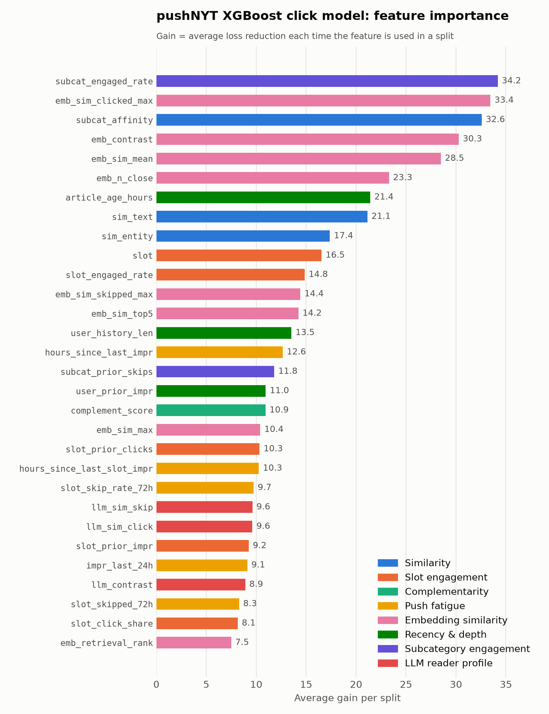
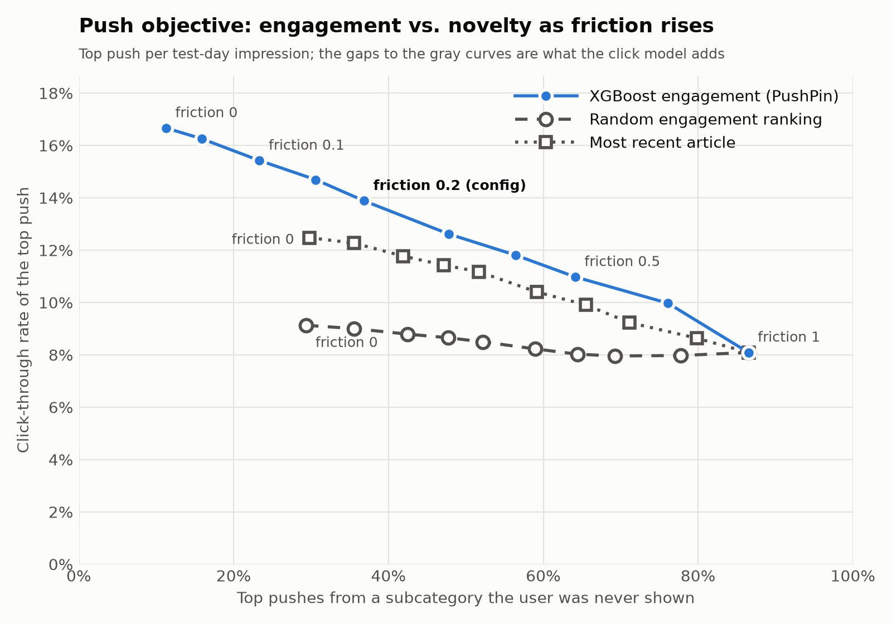

# Model, objective and results

How the click model, push objective and send policy are built and how they score. Short version in the [README](../README.md).

## Overview

PushPin predicts whether a reader will click on a given article if it is pushed to them in a
given time slot, `P(click | user, article, time slot)`. Slots are:

| Slot      | Hours (local) |
|-----------|---------------|
| morning   | 05:00–11:59   |
| afternoon | 12:00–16:59   |
| evening   | 17:00–04:59   |

The model is an XGBoost
classifier trained on the [Microsoft News Dataset (MIND)](https://msnews.github.io/), with
article abstracts embedded into a local [Chroma](https://www.trychroma.com/) vector database for
retrieval features and Claude-written reader profiles. A push objective and send policy on top
decide what to send and whether to send it. It can also send real pushes to your phone; see
[docs/notifier.md](notifier.md).

## Pipeline

```
gs://pushpin-data ──sync-data.sh──▶ data/
                                     │
          news.tsv ──pushpin-embed──▶ data/chroma   (MiniLM abstract embeddings)
                                     │
 behaviors.tsv + chroma ──pushpin-profile──▶ data/llm + chroma  (Claude click/skip themes per user-day)
                                     │
 behaviors.tsv + news.tsv + entity embeddings + chroma + profiles
                                     │
                              pushpin-train            (train container)
                                     │
                                     ▼
          outputs/<run>/  (click model + calibration, return model, metrics, predictions.parquet)
                                     │
                            pushpin-objective          (objective container)
                                     │
                                     ▼
          outputs/<run>/objective/  (engagement-vs-novelty tradeoff, send policy, chosen pushes)

          outputs/<run>/predictions.parquet ──▶ pushpin-api  (api container, :8000)
```

1. **Sync** — `scripts/sync-data.sh` pulls MIND from the project's GCS bucket.
2. **Embed** — `pushpin-embed` encodes each abstract (title if empty) with `all-MiniLM-L6-v2`
   into Chroma (`data/chroma`, collection `abstracts`).
3. **Profile** — `pushpin-profile` (RAG + LLM): for each user-day, retrieves recent clicks and the
   skipped articles nearest to each, and has Claude Haiku name 2-4 themes the user clicks and
   2-4 they skip (Message Batches API). Themes are embedded into a `profiles` collection.
4. **Train** — `pushpin-train` builds features, trains XGBoost with early stopping, calibrates it,
   fits a return model (churn proxy), and evaluates on a held-out day.
5. **Objective** — `pushpin-objective` picks one push per impression (engagement vs. novelty) and
   decides whether to send it. Its own lightweight image; no retraining needed to change it.
6. **Serve** — `pushpin-api` exposes scores and push decisions over HTTP.
7. **Analyze** — `pushpin-exploration` and `pushpin-fatigue` study behavior across the whole log.

**Time-based split.** Impressions before `split.fit_end` only fit complement statistics and user
history; `[fit_end, train_end)` trains (latest `model.valid_fraction` held out for early
stopping); `train_end` onward is test. Every per-user feature uses only strictly earlier impressions.

### Features

Defined in `src/pushpin/features.py`:

| Group | Features | Idea |
|-------|----------|------|
| Time-slot engagement | `slot`, `slot_prior_impr`, `slot_prior_clicks`, `slot_engaged_rate`, `slot_click_share` | Past engagement in this slot, shrunk toward the global rate |
| Similarity | `sim_text`, `sim_entity`, `subcat_affinity` | Candidate vs. history: TF-IDF/SVD text, TransE entities, subcategory mix |
| Complementarity | `complement_score` | Alibaba-style `s_ab = p_ab − q_ab` over subcategories ([background](https://eugeneyan.com/writing/push/)): what users read *next* |
| Push fatigue | `slot_skipped_72h`, `slot_skip_rate_72h`, `impr_last_24h`, `hours_since_last_impr`, `hours_since_last_slot_impr` | Recent skips and volume |
| Embedding retrieval | `emb_sim_mean`, `emb_sim_max`, `emb_sim_top5`, `emb_n_close`, `emb_retrieval_rank` | Candidate vs. history in abstract-embedding space |
| Article recency | `article_age_hours` | Hours since first shown (MIND lacks publish time) |
| User depth | `user_history_len`, `user_prior_impr` | How much we know about the user |
| Subcategory skips | `subcat_engaged_rate`, `subcat_prior_skips` | The user's shrunk click rate and skip count in this subcategory |
| Click/skip contrast | `emb_sim_clicked_max`, `emb_sim_skipped_max`, `emb_contrast` | Closest clicked vs. closest skipped article |
| LLM reader profile | `llm_sim_click`, `llm_sim_skip`, `llm_contrast` | Best-matching Claude click theme vs. skip theme |

### Evaluation and results

`metrics.json` reports overall AUC, log loss, CTR, **group AUC** (mean AUC within impressions
that contain both a click and a non-click — MIND's standard metric), and AUC by time slot.

Bootstrap confidence intervals resample whole impressions, since candidates shown together are
correlated (replicates and level under `evaluation` in `configs/train.yml`; `bootstrap_samples: 0`
skips them). User- and article-level correlation isn't resampled, so the intervals are probably a
little narrow.

**Quality gate.** If test AUC falls below `evaluation.min_auc` (0.644, the lower bound of the
baseline's 95% CI), `pushpin-train` exits with an error after saving its artifacts, so a regression
can't pass silently but the failed run can still be inspected.

Test day 2019-11-14 (1.22M candidates, 30,270 impressions), 95% CIs:

| Run | AUC | Group AUC |
|-----|-----|-----------|
| `baseline-no-emb` | 0.646 (0.644–0.649) | 0.617 (0.614–0.620) |
| `recency-depth-no-emb` (+ recency, user depth) | 0.656 (0.653–0.659) | 0.622 (0.619–0.625) |
| `ablation-no-llm` (all features but LLM) | 0.7026 (0.700–0.705) | 0.6757 (0.673–0.679) |
| `ablation-with-llm` (all features) | **0.7032** (0.701–0.706) | **0.6766** (0.673–0.680) |

Adding recency and user depth lifts AUC by 0.01; `article_age_hours` ranks third by gain. For the
LLM features, `pushpin-compare` scores both runs on the same resampled impressions, so its CI is
for the difference (1,000 paired replicates):

| Metric | With − without LLM | 95% CI | P(no gain) |
|--------|--------------------|--------|------------|
| AUC | +0.0006 | −0.0000 to +0.0013 | 0.027 |
| Group AUC | +0.0009 | −0.0003 to +0.0021 | 0.082 |

The LLM themes add at most about a thousandth of AUC: borderline for AUC, not significant for
group AUC. They rank 23rd, 24th and 27th of 30 by gain, well behind `emb_sim_clicked_max` and
`emb_contrast`, which already use the same clicked/skipped evidence. Details in
[docs/analysis.md](analysis.md#llm-reader-profiles).

Feature importance for the full model, colored by feature group:



### Push objective and send policy

```
score = (1 − friction) · engagement + friction · novelty,     friction ∈ [0, 1]
```

Engagement is `P(click)`; novelty is 1 − the user's prior exposure share in the candidate's
subcategory. Both are percentile-ranked within the impression so friction is a true weight. The
top pick is sent only if

```
calibrated P(click) ≥ threshold + risk_penalty · (1 − P(return))
```

and the user is under `daily_cap` (defaults 0.07, 0.04, 2 in `configs/objective.yml`).

**Trade-off.** Clicks are rare: 3.8% of candidates are clicked, a random pick per impression
clicks 9.1% (the fair baseline, since MIND only logs impressions with a click), and the model's
top pick clicks 16.7%. Sweeping friction (`recency-depth-no-emb`; dashed = random engagement):



| Friction | CTR of top pick | …with random engagement | Top pick from a never-shown subcategory |
|----------|-----------------|-------------------------|-----------------------------------------|
| 0 | 16.7% | 9.1% | 11% |
| 0.1 | 15.4% | 8.8% | 23% |
| 0.2 (default) | 13.9% | 8.5% | 37% |
| 0.3 | 12.6% | 8.2% | 48% |
| 0.5 | 11.0% | 8.0% | 64% |
| 1 | 8.1% | 8.1% | 87% |

Low friction buys novelty cheaply: 0 → 0.2 more than triples the never-shown share for about 3
points of CTR.

**Send policy.** On impressions with 50+ candidates:

| Threshold | Pushes per active user-day | CTR of pushes sent | Predicted CTR |
|-----------|----------------------------|--------------------|---------------|
| 0 (send all, cap 2) | 1.15 | 5.3% | 8.1% |
| 0.05 | 0.72 | 6.4% | 9.4% |
| **0.07 (default)** | **0.41** | **7.9%** | 10.9% |
| 0.10 | 0.14 | 10.3% | 13.9% |

Raising the threshold trades volume for quality as intended; the model over-predicts the level on
this slice (an artifact of MIND's impression sizes, explained in the analysis doc). At the
default, low-risk users get 0.82 pushes/day at 9.3% CTR and high-risk users 0.15/day at 5.3%.


Other findings:

- **Calibration.** Platt scaling fixes overconfidence at the top (ECE 0.35 → 0.24 pts; top bin
  13.2% → 11.1% predicted vs. 10.9% observed) without changing rankings. The top is where the
  send threshold operates, so that's where it matters.
- **Return model.** P(another impression within 24 h), AUC 0.743, stands in for opt-out risk; it
  sets *how much* to send each user, not *what*.
- **Exploration.** A first click on a never-shown subcategory goes with a 2.4× higher re-click rate.
- **Fatigue.** Engagement is ~2% below a user's norm after 5+ impressions in a day, with no
  cumulative weekly effect, supporting a daily cap.

Plots, tables, caveats and what real opt-out logging would add: [docs/analysis.md](analysis.md).
