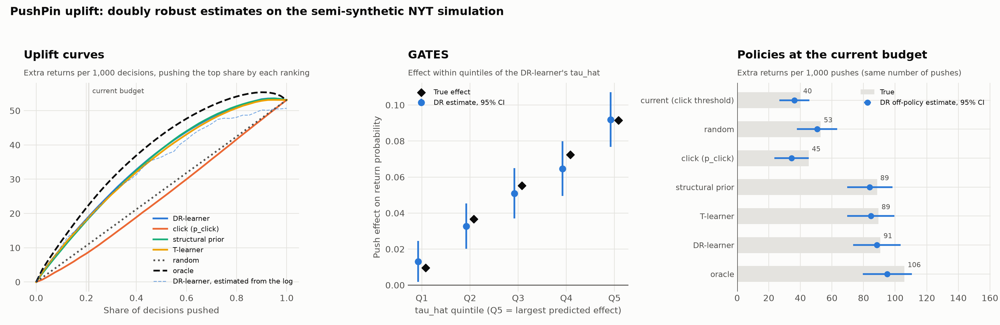

# Uplift: doubly robust estimation of heterogeneous push effects

The click model predicts **who will open a push**. That isn't what the send decision needs. A push
to a reader who would have come back anyway costs attention and adds nothing. The question is
**what the push changes**. This page sets that up with potential outcomes, explains how pushPin
identifies the effect with a randomized holdout, estimates it per reader and slot with a
doubly robust learner (DR-learner), and checks the result on a semi-synthetic version of the NYT
simulation where the true effect is known.

Code: `src/pushpin/uplift.py` (estimation, benchmark), `src/pushpin/uplift_design.py` (the
randomized design, shared with the notifier), `configs/uplift.yml`. Plot: `docs/uplift.png`.

## Contents

- [Potential outcomes](#potential-outcomes)
- [Identification: the randomized holdout](#identification-the-randomized-holdout)
- [The estimator](#the-estimator)
- [Why "doubly robust"](#why-doubly-robust)
- [Heterogeneous effects](#heterogeneous-effects)
- [Choosing and evaluating send policies](#choosing-and-evaluating-send-policies)
- [Results on the semi-synthetic NYT simulation](#results-on-the-semi-synthetic-nyt-simulation)
- [Live logging](#live-logging)
- [Limitations](#limitations)
- [Running it](#running-it)
- [References](#references)

## Potential outcomes

Each decision (a reader, at a slot, with that slot's top article) has two potential outcomes:

```
Y(1) = 1 if the reader comes back (opens the app) within the window when the push is sent
Y(0) = the same, when it is not sent
```

The individual effect is `Y(1) − Y(0)`. Only one of the two is ever observed: the push either went
out or it didn't. This is the **fundamental problem of causal inference**. What can be estimated
are averages:

```
ATE    = E[Y(1) − Y(0)]                 does pushing help, on average?
CATE   τ(x) = E[Y(1) − Y(0) | X = x]     for a decision with features x, how much does a push help?
```

`x` is what the scorer already computes for the pick: `p_click`, `p_return` (the return model),
`novelty`, `subcat_affinity`, `emb_sim_max`, the LLM-profile similarities, `article_age_hours`,
the slot's `hour`, and `pushes_today` (pushes the reader already got that day, a fatigue signal).

The click model estimates `E[click | x, pushed]`, a quantity that only exists in the pushed world.
τ(x) compares the two worlds. A reader who opens 30% of pushes but comes back on their own 95%
of the time has a high `p_click` and a small τ.

The **uplift policy** sends when τ̂(x) is large, not when `p_click` is.

## Identification: the randomized holdout

τ(x) can be computed from observed data only under assumptions. pushPin makes them true by
design rather than hoping they hold:

| Assumption | Meaning | How pushPin gets it |
|---|---|---|
| Unconfoundedness | Whether a decision was pushed is independent of its potential outcomes, given x | Treatment is a coin flip whose bias depends only on logged quantities |
| Overlap (positivity) | Every decision has a chance of landing in either arm: 0 < e(x) < 1 | `holdout` > 0 for eligible picks, `explore` > 0 for ineligible ones |
| Consistency / SUTVA | A reader's outcome depends on their own treatment, and "push" means one thing | One push per slot; carryover across slots is handled with a fatigue covariate and an outcome window shorter than the gap between slots (see [Limitations](#limitations)) |

The design, in `uplift_design.py` and the notifier's `_pick`:

```
eligible = passes the click send policy and the reader is under their daily cap
e(x)     = P(send) = 1 − holdout   if eligible       (0.8)
                   = explore       if not eligible   (0.1 in the sim; 0 live by default)
treated  = draw(push_id) < e(x)                       draw: a SHA-1 of the push id → [0, 1), reproducible
```

The propensity `e(x)` is **known exactly**: it's written on the pick when the decision is made.
That's the strongest form of identification, and it matters for the estimator below.

A withheld article is never offered to that reader again, so the control arm stays unpushed.
Withheld pushes don't count toward the daily cap.

## The estimator

**Step 1: outcome models, cross-fitted.** Readers are split into K = 5 folds (all of a reader's
rows in one fold). For each fold, two XGBoost classifiers are fit on the other four folds:

```
μ₁(x) = E[Y | x, T = 1]      fit on treated rows
μ₀(x) = E[Y | x, T = 0]      fit on control rows
```

They are then predicted on the held-out fold, so every row's μ's come from models that never saw it.

**Step 2: the doubly robust pseudo-outcome**, per row:

```
φ = μ₁(x) − μ₀(x)  +  T · (Y − μ₁(x)) / e(x)  −  (1 − T) · (Y − μ₀(x)) / (1 − e(x))
```

Read it as the outcome models' guess `μ₁ − μ₀`, plus an inverse-propensity-weighted correction
for that guess's error on the arm actually observed. `E[φ | x] = τ(x)`, and `mean(φ)` is the ATE.

**Step 3: the DR-learner.** Regress φ on x with a small, strongly regularized XGBoost (depth 3,
`min_child_weight` 200; φ is noisy, so the second stage must not chase it), also cross-fitted.
Its prediction is τ̂(x), the heterogeneous effect.

The **T-learner** (`μ₁ − μ₀` alone) is reported for comparison. It's the most common uplift model
in practice, but its error is the sum of two models' errors, and nothing corrects them.

## Why "doubly robust"

φ is centered on τ(x) if **either** the outcome models or the propensity is right.

- **μ's right, e wrong.** The correction terms have mean zero, because `E[Y − μ₁(x) | x, T = 1] = 0`
  whatever weight multiplies them. What's left is `μ₁ − μ₀ = τ`.
- **e right, μ's wrong.** `E[T · Y / e(x) | x] = E[Y(1) | x]`: the weight undoes exactly how often
  treated rows appear. Likewise `E[T · μ₁(x) / e(x) | x] = μ₁(x)`, which cancels the leading μ₁.
  Same on the control side. The wrong μ's cancel and `E[Y(1) − Y(0) | x] = τ` remains.

When both are a little wrong, the bias is roughly **(error in e) × (error in μ)**: a product, so
second order. This "orthogonality" (Chernozhukov et al.'s double machine learning) is why
flexible, imperfect learners like XGBoost can be used for μ without biasing τ̂, as long as they
are cross-fitted.

**In pushPin, e is known**, so φ is unbiased however poor the μ's are
(`test_dr_is_unbiased_when_the_outcome_models_are_wrong` checks this with μ = 0.5 everywhere).
What the μ's buy is **variance**. Plain inverse propensity weighting (IPW, φ with μ = 0) is also
unbiased but noisy. Good μ's absorb most of the noise in Y, so the corrections stay small. In the
benchmark below, DR's standard error is 43% smaller than IPW's on the same data.

**What makes this causal ML, not ML next to causal inference.** Three things together:

1. A causal estimand, τ(x), defined with potential outcomes.
2. Identification from the design: randomization with logged propensities.
3. ML confined to the parts that are pure prediction (μ₀, μ₁, the second-stage regression), and
   combined through an orthogonal score so that prediction errors don't bias the causal answer.

The naive alternative, putting T in the click model as a feature and differencing its predictions
(an S-learner), uses ML and causal language too. But regularization can shrink T's effect toward
zero, all of the model's bias flows into τ̂, and there's no valid confidence interval.

## Heterogeneous effects

τ(x) varies. That's the whole reason to target: if τ were constant, the best policy would be
"push everyone" or "push no one." Plausible sources, all already in x:

- **Organic engagement.** Readers who come back anyway have little room to be moved.
- **Interest.** A push in a subcategory the reader likes helps more.
- **Fatigue.** The third push of the day helps less, and can hurt.

τ is never observed for anyone, so τ̂ can't be validated with held-out AUC. Two checks are used instead.

- **GATES** (sorted group average treatment effects; Chernozhukov, Demirer, Duflo and
  Fernández-Val). Sort decisions into quintiles of out-of-fold τ̂, then estimate the DR effect
  `mean(φ)` within each, with standard errors clustered by reader. If τ̂ captures real
  heterogeneity, the effect rises from Q1 to Q5. If it only fits noise, the quintiles look alike.
- **Uplift (Qini) curves.** Rank decisions by a score, push the top share, and accumulate the
  effect. A good ranking rises steeply and early.

## Choosing and evaluating send policies

A policy ranks decisions and pushes the top ones, at most `daily_cap` per reader per day, until
the budget is spent. All policies get the same budget as the current click-threshold policy
(21% of decisions in the sim), so they are compared at equal push volume:

| Policy | Ranks by |
|---|---|
| current (click threshold) | the existing send rule itself (`p_click ≥ threshold + risk_penalty · (1 − p_return)`) |
| click (p_click) | `p_click` |
| structural prior | `p_click · (1 − p_return)`: the push only matters if the reader wouldn't return anyway. Needs no experiment data |
| T-learner | `μ₁ − μ₀` |
| DR-learner | τ̂(x) |
| random | a coin |
| oracle | the true τ (sim only): the ceiling |

**Off-policy evaluation.** A policy's incremental value can be estimated from the log alone,
without running it: `mean(φ)` over the rows it would push. That's the same doubly robust
argument applied to a policy rather than a feature value. In the sim it's checked against the truth.

## Results on the semi-synthetic NYT simulation

**Why semi-synthetic.** No dataset pushPin has observes a no-push outcome. MIND logs only feed
impressions, and the live system has one reader. The standard benchmark design in causal ML (as
with IHDP or ACIC) is to keep **real covariates** and plant a **known outcome model**, then check
that the method recovers it.

- **Covariates:** the 21,000 top picks of the NYT simulation (1,000 MIND users × 21 slots, Dec
  2–8 2024, `outputs/nyt-sim/pushes.parquet`), with every feature the scorer computed. Ten
  replicates of the readers, each with its own coin flips and outcomes: 210,000 decisions,
  10,000 simulated readers. Cross-fitting folds keep all copies of a MIND user together.
- **Design:** `holdout` 0.2, `explore` 0.1, as above. 24.7% of decisions treated.
- **Planted truth:**

```
y0(x) = P(return | no push) = p_return
τ(x)  = 0.25 · (1 − p_return) · interest  −  0.04 · pushes_today
          interest = 0.3 + 0.7 · percentile rank of subcat_affinity
Y ~ Bernoulli(y0 + T · τ)
```

So the push helps readers who wouldn't come back anyway, more when the topic is theirs, and less
(possibly negatively) after earlier pushes that day.



**Average effect.** The true ATE is 0.053 (a push raises the chance of returning by 5.3 points).

| Estimator | Estimate | 95% CI |
|---|---|---|
| Naive: treated mean − control mean | 0.138 | — |
| IPW (φ with μ = 0) | 0.051 | 0.040 to 0.061 |
| **DR** | **0.051** | **0.045 to 0.057** |

The naive comparison is 2.6× too large. Eligible picks are sent 80% of the time and ineligible
ones 10%, and eligible readers are the ones who return anyway (mean `p_return` 0.72 against 0.60
overall). That's confounding created by the design itself, which is exactly what the logged
propensity corrects. IPW and DR are both unbiased; DR's interval is 43% narrower.

**Heterogeneity (GATES).** The DR effect rises steadily across τ̂ quintiles and tracks the truth:

| τ̂ quintile | DR effect (±1.96 SE) | True effect |
|---|---|---|
| Q1 | 0.013 ± 0.011 | 0.010 |
| Q2 | 0.033 ± 0.013 | 0.037 |
| Q3 | 0.051 ± 0.014 | 0.055 |
| Q4 | 0.065 ± 0.015 | 0.072 |
| Q5 | 0.092 ± 0.015 | 0.092 |

τ̂ against the true τ, per decision: correlation 0.70 for the DR-learner (RMSE 0.035), 0.68 for
the T-learner (RMSE 0.040).

**Policies at the current budget** (44,110 pushes each; extra returns per 1,000 pushes):

| Policy | True | DR off-policy estimate (±1.96 SE) | Mean p_click of pushes | Mean p_return |
|---|---|---|---|---|
| current (click threshold) | 40 | 36 ± 10 | 0.114 | 0.72 |
| click (p_click) | 45 | 34 ± 11 | 0.118 | 0.67 |
| random | 53 | 51 ± 13 | 0.071 | 0.60 |
| structural prior | 89 | 84 ± 14 | 0.092 | 0.39 |
| T-learner | 89 | 85 ± 15 | 0.069 | 0.44 |
| **DR-learner** | **91** | **88 ± 15** | 0.067 | 0.43 |
| oracle | 106 | 95 ± 16 | 0.070 | 0.36 |

What this shows:

- **The click policy is worse than random at causing returns.** It concentrates pushes on readers
  who come back anyway. That isn't an artifact of the planted τ: in the real simulation output,
  the current policy's pushes go to readers with mean `p_return` 0.72 against 0.60 overall. The
  planted τ only says that such readers have less to gain.
- **The DR-learner causes 2.3× as many extra returns as the current policy, with the same number
  of pushes, at a lower click rate** (0.067 against 0.114). CTR and causal impact point in
  different directions. That's the core argument for uplift.
- **Off-policy estimates track the truth** within their intervals for every learned policy, from
  the log alone. That's what makes it possible to choose a new send policy without a new A/B test.
  (The oracle's estimate is lower than its true value, within about 1.4 SE.)
- **The structural prior is nearly as good as the learned models here.** That's partly by
  construction: the planted τ shares its main term, `1 − p_return`. The learned models add
  fatigue and interest, which the prior can't see. On real data, where the true τ is unknown,
  the prior is a sensible first send rule, and the DR-learner is how you find out whether it's right.

## Live logging

The notifier already runs the design for app readers (each has an identity, so their outcome
can be measured). The ntfy broadcast isn't randomized.

- **`configs/notifier.yml`:** `holdout: 0.2`, `explore: 0.0`. Exploration sends pushes the click
  policy rejected, so it's off live until the reader agrees to it.
- **`scores` table:** on each top pick, `eligible`, `treated`, `held_out`, `propensity` and
  `decided_ts` (when the outcome window starts, sent or not). Older databases get the columns on start.
- **Outcome:** the iOS app calls `POST /api/session` whenever it comes to the foreground, writing
  to the `sessions` table. `y = 1` if there's a session within `outcome_hours` (3) after
  `decided_ts`. This exists in both arms, unlike a push tap. Sessions started by tapping the push
  count too: bringing the reader back is the effect being measured.
- **`Store.uplift_rows`** returns the randomized picks whose windows have closed, and
  `pushpin-uplift --live` fits on them. Below 200 rows it reports the IPW average effect only;
  from 200 rows the DR average effect; from 2,000 rows τ̂, GATES and policies too.

With one reader, live data demonstrates the pipeline rather than producing a significant
estimate: at a few decisions a day and 20% held out, the average effect alone would take many months.
The benchmark is where the method is validated, and the live log is how it would be measured for real.

## Limitations

- **The effect size is planted.** The benchmark shows the method recovers a known τ and that
  uplift-ranked policies beat click-ranked ones *when τ looks like this*. It doesn't measure how
  large push effects are for real NYT readers. Only the live log can do that.
- **Carryover.** Today's push can change behavior at later slots. `pushes_today` enters x, and the
  outcome window (3 h) is shorter than the gap between slots, but a policy that sends differently
  also changes `pushes_today` for later decisions. Policy comparisons hold each decision's history
  fixed (one-step evaluation). A multi-step evaluation would need a sequential model (off-policy RL).
- **Short-term outcome.** "Came back within 3 hours" is a proxy for what a publisher cares about:
  retention, subscription and opt-outs. A surrogate index (Athey, Chetty, Imbens and Kang) could
  link short-term outcomes to long-term ones once there's enough history.
- **Positivity live.** With `explore: 0`, the live log only identifies τ for picks the click policy
  already likes. τ̂ shouldn't be trusted far outside that region until exploration is turned on.
- **Budget.** Policies here share one global budget. A per-reader budget with a learned shadow
  price (a Lagrangian dual: send if τ̂ > λ_reader) is the natural next step, and would replace the
  hand-set light / medium / heavy caps.

## Running it

```bash
# semi-synthetic benchmark (needs outputs/nyt-sim from pushpin-nyt-sim or the push-job service)
uv run pushpin-uplift                           # or: docker compose run --rm uplift
# live: the notifier's database (SQLite path or Postgres URL)
uv run pushpin-uplift --live --db outputs/notifier/pushes.db
```

Outputs go to `outputs/uplift/<sim|live>/`: `summary.json`, `gates.csv`, `policies.csv`,
`qini.csv`, `rows.parquet` (per-decision μ₀, μ₁, φ, τ̂), and `uplift.png` (sim). The sim takes
about 15 s on a laptop. It needs XGBoost, so in Docker it runs on the `pushpin-train` image.

Tests: `tests/test_uplift.py` covers double robustness with wrong outcome models, the variance
reduction, clustered standard errors, the reproducible draw, end-to-end recovery on a small
synthetic benchmark, the notifier's holdout (logged, not sent, not counted toward the cap, not
re-offered), session logging, and the outcome query.

## References

- Rubin, D. (1974). Estimating causal effects of treatments in randomized and nonrandomized studies. The potential outcomes framework.
- Kennedy, E. (2023). Towards optimal doubly robust estimation of heterogeneous causal effects. *Electronic Journal of Statistics*. The DR-learner.
- Chernozhukov, V. et al. (2018). Double/debiased machine learning for treatment and structural parameters. *Econometrics Journal*. Orthogonal scores and cross-fitting.
- Chernozhukov, V., Demirer, M., Duflo, E. and Fernández-Val, I. Generic machine learning inference on heterogeneous treatment effects in randomized experiments. GATES.
- Künzel, S. et al. (2019). Metalearners for estimating heterogeneous treatment effects using machine learning. *PNAS*. T-, S- and X-learners.
- Dudík, M., Langford, J. and Li, L. (2011). Doubly robust policy evaluation and learning. *ICML*.
- Radcliffe, N. (2007). Using control groups to target on predicted lift. Qini curves.
- Athey, S., Chetty, R., Imbens, G. and Kang, H. (2019). The surrogate index.
- Zhao, B. et al. (2018). Notification volume control and optimization system at Pinterest. *KDD*.
- Tu, Y. et al. (2019). Personalized treatment selection using causal heterogeneity (LinkedIn notifications and ads). arXiv:1901.10550.
